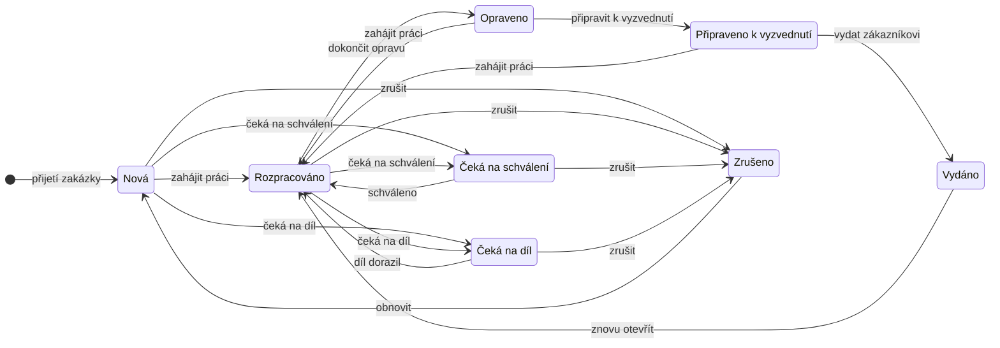

# Funkce aplikace

Tato část popisuje hlavní funkce aplikace z pohledu uživatele i z pohledu toho, co se při jejich použití děje uvnitř systému. U každé funkce je uvedeno, k čemu slouží, jak ji uživatel používá, co probíhá na pozadí, které části systému se na ní podílejí a se kterými tabulkami a soubory pracuje. Přehled funkcí shrnuje následující tabulka.

| **Funkce**                 | **Kde v aplikaci**                               | **Hlavní tabulky a soubory**                                                            |
|:---------------------------|:-------------------------------------------------|:----------------------------------------------------------------------------------------|
| Přijetí zakázky            | Zakázky → Nová zakázka               | Zakazka, Zakaznik, Zarizeni, ZakazkaKontakt, Fotografie, ProvedenyUkon, PouzityMaterial |
| Řízení stavu zakázky       | detail zakázky                                   | Zakazka, StavZakazky, HistorieZmen, KalendarUdalost                                     |
| Evidence zákazníků         | Zákazníci                                        | Zakaznik, KontaktniOsoba, ZakaznikKontakt                                               |
| Evidence zařízení          | Zařízení                                         | Zarizeni, Zakazka                                                                       |
| Fotografie a přílohy       | detail zakázky                                   | Fotografie, Priloha, složka `media`                                                     |
| Práce a materiál           | detail zakázky, Nastavení → Katalogy | ProvedenyUkon, TypUkonu, PouzityMaterial, Material                                      |
| Cenová nabídka             | detail zakázky, Dokumenty                        | Nabidka, PolozkaNabidky                                                                 |
| Faktura a platby           | detail zakázky, Dokumenty                        | Faktura, PolozkaFaktury, Platba                                                         |
| Přijaté objednávky         | detail zakázky, Dokumenty                        | Objednavka, Priloha                                                                     |
| Číslování dokladů          | Nastavení → Dokumenty → Číslování dokladů        | CiselnaRada                                                                             |
| Export faktury do ISDOC    | náhled a detail faktury                          | Faktura, PolozkaFaktury, NastaveniFirmy                                                 |
| Přijaté faktury            | Dokumenty → Přijatá faktura z ISDOC  | PrijataFaktura, Dodavatel, KalendarUdalost                                              |
| Zakázkový list a dokumenty | detail zakázky, náhled dokumentu                 | SablonaDokumentu, šablony, PDF                                                          |
| Šablony dokumentů          | Dokumenty → Šablony dokumentů                | SablonaDokumentu, `media/sablony/`                                                      |
| Pracovní plocha            | Pracovní plocha, detail zakázky                  | všechny tabulky zakázky, soubory                                                        |
| Kalendář                   | Kalendář                                         | KalendarUdalost                                                                         |
| Vyhledávání                | všechny formuláře a seznamy                      | podle typu záznamu                                                                      |
| Správa záznamů a nastavení | Nastavení, administrace                          | číselníky, NastaveniFirmy, SazbaDPH, Zamestnanec, Role                                  |
| Průvodce prvním spuštěním  | první otevření aplikace                          | auth_user, NastaveniFirmy                                                               |
| Historie změn              | záložka Historie, Nastavení                      | HistorieZmen                                                                            |
| Tmavý režim                | tlačítko v horní liště                           | žádné (volba se ukládá v prohlížeči)                                                    |

*Přehled hlavních funkcí aplikace*

## Přijetí a vytvoření zakázky

**K čemu slouží.** Funkce zaznamená přijetí zařízení do opravy. Odpovídá vyplnění papírového zakázkového listu, který se ve firmě používal dříve, a proto jsou všechny údaje na jedné obrazovce v pořadí, v jakém je pracovník od zákazníka zjišťuje.

**Jak ji uživatel používá.** Ve formuláři „Nová zakázka“ pracovník vyhledá zákazníka zadáním části jména, firmy, telefonu nebo IČO. Pokud zákazník neexistuje, založí ho tlačítkem „+ Nový“ v dialogovém okně bez opuštění formuláře. Poté vybere jedno nebo více zařízení zákazníka (aplikace nabízí jen zařízení vybraného zákazníka) nebo založí nové, vybere kontaktní osobu a její roli (např. „Přinesl zařízení“), upraví datum přijetí, zapíše popis závady, nahraje fotografie, případně rovnou zadá první práce a materiál, vybere, kdo zařízení převzal, a zakázku uloží.

**Co se děje na pozadí.** Pohled `zakazka_nova` zkontroluje, že je vybrán zákazník, a v jedné databázové transakci vytvoří záznam zakázky se stavem „Nová“. Metoda `save()` modelu přidělí číslo zakázky podle číselné řady zakázek (další volné pořadové číslo v daném období, s kontrolou, že číslo ještě neexistuje; viz [Číslování dokladů](#číslování-dokladů)). K zakázce se připojí vybraná zařízení (jen ta, která patří vybranému zákazníkovi), zaměstnanec, který zařízení převzal, a kontaktní osoba s rolí; pokud kontaktní osoba dosud nebyla u zákazníka evidována, vytvoří se i vazba zákazník–kontakt. Nahrané soubory se uloží jako fotografie (pouze soubory s typem obrázku). Zadané práce a materiál se uloží s cenou a sazbou DPH. Signál `post_save` vytvoří v kalendáři událost „Přijetí zakázky“ a do historie změn se zapíše vytvoření zakázky. Uživatel je poté přesměrován na pracovní plochu nové zakázky.

**Části systému a data.** Pohled `zakazka_nova`, šablona `zakazka_nova.html`, vyhledávací pole (`LookupWidget` a pohledy `lookup`, `lookup_new`), modely a signály. Tabulky Zakazka, Zakaznik, Zarizeni, KontaktniOsoba, ZakazkaKontakt, ZakaznikKontakt, Fotografie, ProvedenyUkon, PouzityMaterial, KalendarUdalost, HistorieZmen; soubory ve složce `media/fotky/`.

## Řízení stavu zakázky

**K čemu slouží.** Stav zakázky ukazuje, v jaké fázi se oprava nachází, a umožňuje rychle zjistit, která zařízení jsou ve firmě, na co se čeká a co je připraveno k vyzvednutí.

**Jak ji uživatel používá.** V detailu zakázky se pod nadpisem zobrazuje aktuální stav a tlačítka akcí, které jsou v tomto stavu dovoleny, například u nové zakázky „Zahájit práci“, „Čeká na schválení“, „Čeká na díl“ a „Zrušit zakázku“. Popisky tlačítek se přizpůsobují situaci (u zakázky čekající na díl se tlačítko jmenuje „Díl dorazil – zahájit práci“). Uživatel s oprávněním může stav změnit i ručně výběrem ze seznamu.

**Co se děje na pozadí.** Povolené přechody mezi stavy jsou v kódu popsány slovníkem `FLOW` (stav → seznam povolených akcí) a slovníkem `ACTIONS` (akce → cílový stav). Pohled `stav_akce` ověří, že požadovaná akce je v aktuálním stavu povolena, a funkce `set_stav` změní stav a zapíše změnu do historie. Při akci „Vydat zákazníkovi“ se navíc uloží datum vydání, do historie se zapíše, kdo zařízení vydal, a vytvoří se událost kalendáře „Vydání zařízení“ přiřazená tomuto zaměstnanci. Při znovuotevření vydané zakázky se datum vydání smaže. Ruční změnu stavu povolí funkce `can_set_stav` jen správci nebo zaměstnanci s rolí administrátora či s oprávněním `zakazky.zmenit_stav`. Stav zakázky je záměrně nezávislý na stavu nabídek, faktur a plateb; výjimkou je vytvoření nabídky u nové zakázky, které ji přepne do stavu „Čeká na schválení“.

*Přechody mezi stavy zakázky (podle slovníků `FLOW` a `ACTIONS` v `core/views.py`)*

**Části systému a data.** Pohledy `stav_akce`, `set_stav`, `can_set_stav` a `stav_ctx` v `core/views.py`; tabulky Zakazka, StavZakazky, Zamestnanec, Role, Opravneni, HistorieZmen a KalendarUdalost. Přechody znázorňuje diagram výše.

## Evidence zákazníků

**K čemu slouží.** Udržuje jednotný seznam zákazníků s kontaktními a fakturačními údaji, ze kterého čerpají všechny zakázky a doklady.

**Jak ji uživatel používá.** Sekce Zákazníci zobrazuje seznam zákazníků (jako tabulku nebo jako kartičky v zobrazení kanban) s typem (F = firma, SO = soukromá osoba), kontaktními údaji a datem poslední změny, s vyhledáváním a stránkováním po 50 záznamech. Detail zákazníka je rozdělen do záložek Informace, Kontaktní osoby, Zařízení, Zakázky, Dokumenty a Historie, takže na jednom místě je vidět celá historie spolupráce se zákazníkem.

**Co se děje na pozadí.** Při ukládání formuláře se kontroluje formát IČO (osm číslic a kontrolní součet podle algoritmu modulo 11), DIČ a telefonu. Při zakládání zákazníka z dialogového okna aplikace ověří, že je vyplněno jméno nebo firma, a pokud již existuje zákazník se stejným IČO, nový záznam nevytvoří a upozorní na existující. Datum poslední změny v seznamu se zjišťuje poddotazem do historie změn. Smazání zákazníka znamená jeho deaktivaci; zákazník s navázanými zakázkami nebo doklady nemůže být z databáze odstraněn.

**Části systému a data.** Obecný pohled seznamu `lst`, pohled `zakaznik_detail`, šablona `zakaznik_detail.html`; tabulky Zakaznik, KontaktniOsoba, ZakaznikKontakt a pro záložky také Zarizeni, Zakazka, Nabidka, Objednavka, Faktura a HistorieZmen.

## Evidence zařízení

**K čemu slouží.** Poskytuje přehled všech zařízení zákazníků a odpovídá na otázky, která zařízení jsou právě ve firmě, která čekají na díl a jaká je historie oprav konkrétního stroje.

**Jak ji uživatel používá.** Přehled zařízení lze filtrovat (všechna zařízení, na firmě, v opravě, čeká na díl, u zákazníka, bez zakázky, neaktivní), dále podle stavu poslední zakázky a podle toho, zda je zařízení ve firmě. Lze vyhledávat podle výrobce, typu, sériového čísla, zákazníka, telefonu i čísla zakázky a řadit podle sloupců. Detail zařízení zobrazuje aktuální otevřenou zakázku a chronologický seznam všech zakázek zařízení včetně provedených prací, materiálu a jejich cen.

**Co se děje na pozadí.** Stav zařízení se v databázi neukládá. Pohled `zarizeni_prehled` načte zařízení i s jejich zakázkami seřazenými od nejnovější (`prefetch_related`, aby počet dotazů nerostl s počtem zařízení) a stav určí podle poslední zakázky: zařízení je „na firmě“, pokud jeho poslední zakázka není ve stavu Vydáno nebo Zrušeno. Datum poslední akce se počítá z data založení zařízení, poslední změny jeho zakázek a historie změn. Detail zařízení dopočítává cenu práce a materiálu jednotlivých zakázek.

**Části systému a data.** Pohledy `zarizeni_prehled` a `zarizeni_detail`; tabulky Zarizeni, Zakazka, StavZakazky, ProvedenyUkon, PouzityMaterial, HistorieZmen.

## Fotografie a přílohy

**K čemu slouží.** Umožňují ke zakázce uložit fotodokumentaci stavu zařízení a libovolné další soubory (dokumenty zákazníka, technické listy, objednávky).

**Jak ji uživatel používá.** Fotografie lze nahrát již při přijetí zakázky (i více najednou) nebo kdykoli později tlačítky „Přidat fotografii“ a „Přidat přílohu“ na pracovní ploše zakázky. Soubory se pak zobrazují na záložkách Fotografie a Přílohy a otevírají se v prohlížeči dokumentů.

**Co se děje na pozadí.** Django uloží nahraný soubor do složky `media/fotky/RRRR/MM/`, resp. `media/prilohy/RRRR/MM/`, a do databáze zapíše cestu, popis, autora a čas nahrání. U přílohy se z přípony souboru automaticky určí typ souboru. Podle přípony aplikace rozhodne, jak soubor zobrazit: obrázky přímo v prohlížeči s možností přiblížení, PDF ve vloženém rámu, ostatní soubory jen ke stažení. Soubory jsou dostupné pouze přihlášeným uživatelům.

**Části systému a data.** Obecný formulář `edit` s nahráním souboru, pracovní plocha; tabulky Fotografie a Priloha, složka `media`.

## Práce s materiálem a časem

**K čemu slouží.** Evidence provedených prací a použitého materiálu je podkladem pro ocenění zakázky a pro položky nabídky a faktury.

**Jak ji uživatel používá.** Na pracovní ploše zakázky uživatel tlačítkem „Přidat práci“ vybere typ úkonu z katalogu, zadá cenu bez DPH, sazbu DPH, pracovníky, kteří práci provedli, a případně poznámku. Tlačítkem „Přidat materiál“ vyhledá materiál v katalogu (nebo ho rovnou založí), zadá množství a aplikace sama doplní poslední známou cenu. Záložky Práce a Materiál zobrazují souhrny bez DPH. Časová náročnost práce se v aplikaci vyjadřuje cenou úkonu a u položek s jednotkou hodina množstvím hodin; samostatná evidence odpracovaného času (docházka) není předmětem aplikace.

**Co se děje na pozadí.** Při výběru materiálu vrátí vyhledávací pohled `lookup` ve formátu JSON i poslední cenu materiálu a skript ji vloží do pole ceny. Při uložení použitého materiálu bez ceny metoda `save()` zkopíruje cenu z katalogu. Materiál s cenou je tak k zakázce „zamrazen“ a změna ceníku neovlivní starší zakázky. Při zakládání materiálu se kontroluje, zda materiál se stejným názvem již neexistuje. Pokud práce nebo materiál nemají sazbu DPH, použije se při tvorbě dokladu výchozí sazba z nastavení firmy.

**Části systému a data.** Obecné formuláře, vyhledávací pole, modely `ProvedenyUkon` a `PouzityMaterial`; tabulky ProvedenyUkon, TypUkonu, PouzityMaterial, Material, Zamestnanec, NastaveniFirmy.

## Tvorba cenových nabídek

**K čemu slouží.** Vytváří cenovou nabídku pro zákazníka z prací a materiálu evidovaných u zakázky, bez ručního přepisování položek.

**Jak ji uživatel používá.** Na pracovní ploše zakázky uživatel klikne na „Vytvořit nabídku“. Otevře se formulář s předvybranou zakázkou, datem vystavení a poznámkou; pod ním se zobrazí náhled položek, které budou do nabídky převzaty, včetně součtů. Při změně zakázky se náhled načte znovu (htmx). Po potvrzení se uživateli rovnou zobrazí hotová nabídka ve výchozí šabloně, kterou může vytisknout nebo stáhnout jako PDF.

**Co se děje na pozadí.** Funkce `nabidka_polozky` sestaví položky: každá provedená práce se stane položkou s množstvím 1 ks a názvem typu úkonu (doplněným o první řádek poznámky), každý použitý materiál položkou s množstvím, jednotkou a cenou za jednotku. Chybějící sazba DPH se nahradí výchozí sazbou firmy. Pohled `nabidka_nova` pak v transakci vytvoří záznam nabídky s číslem odvozeným z čísla zakázky (metoda `cislo_ze_zakazky`), zkopíruje do něj údaje zákazníka a identifikační čísla zakázky, propojí nabídku se zakázkou a uloží položky. Každá položka si při uložení spočítá cenu bez DPH a s DPH a přepočítá součty nabídky. Nová zakázka se přepne do stavu „Čeká na schválení“.

**Části systému a data.** Pohledy `nabidka_nova` a `nabidka_nahled`, htmx, model `Nabidka` a `PolozkaNabidky`, systém šablon pro zobrazení; tabulky Nabidka, PolozkaNabidky, Zakazka, ProvedenyUkon, PouzityMaterial, Zakaznik, NastaveniFirmy, HistorieZmen.

## Tvorba faktur a evidence plateb

**K čemu slouží.** Vystavuje fakturu za provedenou opravu a eviduje její úhradu.

**Jak ji uživatel používá.** Tlačítkem „Vytvořit fakturu“ na pracovní ploše zakázky se otevře formulář s datem vystavení (dnešní datum), datem uskutečnění zdanitelného plnění (nepovinné, výchozí je datum vystavení), datem splatnosti (výchozí 14 dní) a poznámkou a s náhledem položek. Po uložení se zobrazí hotová faktura. Spolu s fakturou se automaticky založí platba ve stavu „Čeká na zaplacení“. Po úhradě uživatel v detailu faktury stiskne **✓ Zaplaceno**. Platbu, ke které faktura neexistuje (např. platbu v hotovosti), lze zapsat přímo k zakázce.

**Co se děje na pozadí.** Formulář ověří, že splatnost není dřívější než datum vystavení. Pohled `faktura_nova` v transakci vytvoří fakturu a položky stejným způsobem jako u nabídky. Číslo faktury přidělí metoda `save()` modelu podle číselné řady faktur. Ve výchozím nastavení má tvar `NNN-DD-MM/RRRR`: pořadové číslo NNN je o jedna vyšší než nejvyšší pořadové číslo faktur vystavených ve stejném roce, za ním následuje den, měsíc a rok vystavení. Spolu s fakturou se v téže transakci vytvoří platba „Čeká na zaplacení“ s částkou faktury. Variabilní symbol pro platební údaje se v dokumentu odvodí z čísla faktury vynecháním oddělovačů. Signál vytvoří v kalendáři událost „Fakturováno“. Tlačítko „Zaplaceno“ (pohled `faktura_zaplaceno`) přepne platbu na „Zaplaceno“ a doplní datum úhrady; při uložení platby se stavem „Zaplaceno“ vznikne událost „Zaplaceno“.

**Části systému a data.** Pohledy `faktura_nova` a `faktura_zaplaceno`, formulář `FakturaForm`, modely `Faktura`, `PolozkaFaktury`, `Platba`, signály; tabulky Faktura, PolozkaFaktury, Platba, KalendarUdalost, HistorieZmen.

## Zakázkový list a výsledné dokumenty

**K čemu slouží.** Umožňuje zobrazit, vytisknout a stáhnout jako PDF zakázkový list, nabídku nebo fakturu ve firemním vzhledu.

**Jak ji uživatel používá.** Tlačítko „Zakázkový list“ na pracovní ploše nebo vytvoření dokladu otevře náhled dokumentu. Nad náhledem jsou tlačítka „Stáhnout PDF“, „Vytisknout“, „Změnit šablonu“ a „Zpět“. Volba „Změnit šablonu“ zobrazí miniatury všech aktivních šablon daného typu vedle sebe; kliknutím na miniaturu se dokument zobrazí v jiné šabloně, aniž by se změnila výchozí šablona. Stažené PDF má název podle firemních zvyklostí, například `ZL_048.pdf` pro zakázkový list, `DMN_048.pdf` pro nabídku a `Fa001.pdf` pro fakturu.

**Co se děje na pozadí.** Náhled je stránka s vloženým rámem, který načítá obsah dokumentu. Pohled `dokument_obsah` vybere šablonu (zvolenou v adrese, jinak výchozí), načte objekt a zavolá metodu `data()` příslušného typu dokumentu, která sestaví všechna data dokumentu z databáze. Renderer pak z šablony a dat vytvoří PDF (Excelové šablony) nebo HTML (HTML šablony). Hotová PDF se ukládají do vyrovnávací paměti, a pokud se nezmění šablona ani data, další zobrazení je okamžité. Podrobnosti popisuje část [Šablony dokumentů](08-sablony-dokumentu.md).

**Části systému a data.** Pohledy `dokument`, `dokument_obsah`, `dokument_pdf` a `dokument_sablony`, balíček `core/sablony`, LibreOffice; tabulka SablonaDokumentu a data dokumentu, soubory šablon, `media/cache/dokumenty/`.

## Práce s Excelovými šablonami

**K čemu slouží.** Umožňuje firmě používat pro dokumenty vlastní Excelové formuláře a upravovat je bez programování.

**Jak ji uživatel používá.** V části Dokumenty → Šablony dokumentů (odkaz je i v Nastavení → Dokumenty) jsou šablony seskupeny podle typu dokumentu, každá s miniaturou. Uživatel může nahrát novou šablonu (`.xlsx`, `.xlsm`, `.xls` nebo `.html`), nastavit šablonu jako výchozí, vytvořit kopii, deaktivovat ji, zkontrolovat rozpoznaná pole, zobrazit ji s ukázkovými daty, stáhnout soubor, vrátit vestavěnou šablonu do původní podoby nebo ji upravit ve webovém editoru přetahováním polí. Stránka „Značky pro vlastní šablony“ obsahuje seznam všech polí, která lze do šablony vložit, a vzorové šablony ke stažení.

**Co se děje na pozadí.** Po nahrání souboru se šablona analyzuje, nalezené značky a rozpoznaná pole se uloží do sloupce `mapovani` a zvýší se verze šablony. Starý formát `.xls` se nejprve převede na `.xlsx`. Tato funkce je jádrem celé práce s dokumenty, a proto je jí věnována samostatná kapitola [Šablony dokumentů](08-sablony-dokumentu.md).

**Části systému a data.** Pohledy v `core/views_sablony.py`, moduly balíčku `core/sablony`, šablona `sablony/editor.html`; tabulka SablonaDokumentu, složky `media/sablony/` a `core/sablony/vzory/`.

## Generování PDF

**K čemu slouží.** PDF je formát, ve kterém se dokumenty předávají zákazníkům, archivují a tisknou.

**Jak ji uživatel používá.** PDF se vytvoří tlačítkem „Stáhnout PDF“ v náhledu dokumentu nebo tlačítkem „Stáhnout“ v prohlížeči dokumentů na pracovní ploše. U Excelových šablon se PDF zobrazuje přímo i v náhledu.

**Co se děje na pozadí.** Renderer vyplní šablonu daty, uloží výsledek do dočasné složky a funkce `na_pdf` spustí LibreOffice v režimu bez okna s parametrem `--convert-to pdf`. Výsledné PDF se uloží do vyrovnávací paměti pod klíčem vypočteným hašovací funkcí SHA-1 z identifikace a verze šablony, času změny souboru šablony, mapování a všech dat dokumentu. Jakákoli změna dat nebo šablony tak vede k novému PDF, zatímco opakované zobrazení stejného dokumentu převod nespouští. Převod jednoho dokumentu trvá přibližně jednu až tři sekundy. Pokud LibreOffice v počítači chybí, aplikace zobrazí srozumitelnou zprávu s odkazem na jeho stažení.

**Části systému a data.** `renderery.py`, `prevod.py`, LibreOffice; složka `media/cache/dokumenty/`.

## Export do formátu ISDOC

**K čemu slouží.** ISDOC je český standard elektronické faktury ve formátu XML. Zákazník, který fakturu obdrží v tomto formátu, ji může načíst přímo do svého účetního programu bez ručního přepisování údajů.

**Jak ji uživatel používá.** V náhledu faktury je vedle tlačítka „Stáhnout PDF“ tlačítko „Stáhnout ISDOC“, v detailu faktury tlačítko „ISDOC“. Kliknutím se stáhne soubor pojmenovaný stejně jako PDF, jen s příponou `.isdoc` (např. `Fa001.isdoc`), který lze poslat zákazníkovi spolu s PDF. Na zvolené šabloně export nezávisí.

**Co se děje na pozadí.** Pohled `dokument_isdoc` načte fakturu a předá ji modulu `isdoc.py`. Ten z dat typu dokumentu Faktura sestaví dokument XML podle formátu ISDOC 6.0.2: rozdělí adresy a číslo účtu na části, které formát vyžaduje, vytvoří řádky faktury, rekapitulaci DPH podle sazeb, součty a platební údaje. Dokument se ověří proti oficiálnímu schématu XSD a teprve potom se odešle ke stažení. Podrobný popis převodu je v části [Export do formátu ISDOC](08-sablony-dokumentu.md#export-do-formátu-isdoc).

**Části systému a data.** `core/sablony/isdoc.py`, `core/sablony/schemata/isdoc-invoice-6.0.2.xsd`, pohled `dokument_isdoc`, adresa `/dokument/faktura/<id>/isdoc/`; tabulky faktur, položek faktur a nastavení firmy.

## Evidence přijatých faktur

**K čemu slouží.** Eviduje faktury, které firmě posílají dodavatelé (například za náhradní díly nebo nářadí), a hlídá, zda a kdy byly zaplaceny. Firma tak na jednom místě vidí své závazky a v kalendáři má přehled o tom, kdy která faktura přišla, kdy je splatná a kdy byla uhrazena.

**Jak ji uživatel používá.** V části Dokumenty uživatel klikne na tlačítko „⬆ Přijatá faktura z ISDOC“ a nahraje soubor, který mu dodavatel poslal (`.isdoc` nebo archiv `.isdocx`). Volitelně může fakturu přiřadit k zakázce, například když jde o díl pro konkrétní opravu. Aplikace fakturu uloží a zobrazí její detail ke kontrole. Fakturu, která přišla jen jako PDF nebo na papíře, lze zadat tlačítkem „+ Přijatá faktura ručně“. Po úhradě uživatel v detailu faktury stiskne tlačítko „Zaplaceno“. V seznamu dokumentů jsou nezaplacené faktury a faktury po splatnosti označeny barevným štítkem.

**Co se děje na pozadí.** Funkce `nacti` v modulu `isdoc.py` přečte ze souboru údaje faktury a dodavatele (podrobně v části [Import přijatých faktur](08-sablony-dokumentu.md#import-přijatých-faktur-ve-formátu-isdoc)). Pohled `prijata_faktura_import` vyhledá dodavatele podle IČO, případně podle názvu; pokud dodavatel v evidenci není, založí ho, a pokud je, doplní mu jen chybějící údaje. Před uložením zkontroluje, zda stejná faktura od stejného dodavatele již v evidenci není, a upozorní uživatele, pokud faktura není vystavena na IČO jeho firmy. Původní soubor se uloží ke faktuře do složky `media/prijate_faktury/`. Uložení faktury vyvolá signál, který v kalendáři vytvoří nebo aktualizuje události doručení, splatnosti a zaplacení. Událost splatnosti nese v názvu stav úhrady a v kalendáři je červená, dokud faktura není zaplacena, potom zelená.

**Části systému a data.** Pohledy `prijata_faktura_import`, `prijata_faktura_rucne` a `prijata_faktura_zaplaceno`, modul `core/sablony/isdoc.py`, signál v `models.py`; tabulky PrijataFaktura, Dodavatel, KalendarUdalost, HistorieZmen; složka `media/prijate_faktury/`.

## Kalendář

**K čemu slouží.** Poskytuje časový přehled o přijatých a vydaných zakázkách, vystavených fakturách, platbách, přijatých fakturách od dodavatelů a jejich splatnosti a o ručně zadaných termínech.

**Jak ji uživatel používá.** Kalendář lze zobrazit po měsících, týdnech nebo dnech, přecházet šipkami, tlačítkem „Dnes“ nebo výběrem měsíce, roku a konkrétního data. Události lze filtrovat podle typu a podle zaměstnance a jsou barevně odlišeny podle typu. Vlastní událost (např. termín vyzvednutí nebo servisní výjezd) lze přidat tlačítkem „+ Událost“, nebo rychleji tlačítkem „+“ přímo u dne: otevře se okno se základními poli (název, datum, typ, popis) a ostatní údaje jsou schované v rozšířených možnostech.

**Co se děje na pozadí.** Většina událostí vzniká automaticky signály modelů (přijetí zakázky, vystavení faktury, zaplacení, doručení, splatnost a zaplacení přijaté faktury) nebo při vydání zařízení. Pohled `kalendar` vypočítá rozsah zobrazených dní (u měsíce včetně dní sousedních měsíců do celých týdnů pomocí modulu `calendar`), načte události v tomto rozsahu a seskupí je podle dne v místním čase.

**Části systému a data.** Pohled `kalendar`, šablona `kalendar.html`, signály v `models.py`; tabulky KalendarUdalost, Zamestnanec, Zakazka, Faktura, Platba, PrijataFaktura.

## Pracovní plocha a práce se soubory

**K čemu slouží.** Pracovní plocha je místo, kde administrativní pracovník tráví většinu času. Úvodní obrazovka slouží k rychlému nalezení zakázky, detail zakázky ke zpracování všeho, co se zakázky týká, na jedné obrazovce.

**Jak ji uživatel používá.** Úvodní pracovní plocha nabízí vyhledávání zakázek (podle čísla, zákazníka, popisu závady, sériového čísla nebo typu zařízení), seznam naposledy otevřených zakázek, seznam otevřených zakázek a dnešní události z kalendáře. Detail zakázky je rozdělen na dvě poloviny. Vlevo jsou záložky Přehled, Práce, Materiál, Fotografie, Přílohy, Dokumenty, Kontakty, Zařízení, Zaměstnanci a Historie a tlačítka akcí. Vpravo je prohlížeč dokumentů, ve kterém se otevírají fotografie, přílohy i vytvořené dokumenty. Prohlížeč umožňuje přibližovat kolečkem myši, posouvat tažením, přecházet mezi soubory stejné skupiny šipkami na klávesnici, soubor stáhnout, vytisknout, otevřít v novém okně nebo smazat a zapnout režim porovnání se dvěma panely vedle sebe (např. fotografie a zakázkový list).

**Co se děje na pozadí.** Pohled `plocha` sestaví seznam všech zobrazitelných položek zakázky: fotografie, přílohy, zakázkový list, nabídky, faktury a objednávky. U každé položky určí druh zobrazení (obrázek, PDF, HTML dokument, ostatní soubor) a adresu pro zobrazení a stažení; u dokumentů je adresou zobrazení obsah ve výchozí šabloně a adresou stažení PDF. Seznam se předá do stránky jako JSON a prohlížeč dokumentů s ním pracuje v JavaScriptu. Pohled zároveň uloží zakázku do seznamu naposledy otevřených zakázek v relaci uživatele (nejvýše osm) a spočítá souhrny prací a materiálu.

**Části systému a data.** Pohledy `plocha_home` a `plocha`, šablony `plocha_home.html` a `plocha.html`, relace Django; všechny tabulky navázané na zakázku a soubory ve složce `media`.

## Vyhledávání a výběr záznamů

**K čemu slouží.** Zrychluje zadávání údajů a zabraňuje vzniku duplicitních záznamů.

**Jak ji uživatel používá.** Místo rozbalovacích seznamů obsahují formuláře u zákazníka, zařízení, kontaktní osoby a materiálu vyhledávací pole. Uživatel začne psát a po krátké prodlevě se zobrazí až 12 odpovídajících záznamů s doplňujícími údaji (u zařízení sériové číslo, zákazník a počet zakázek, u materiálu jednotka a cena). Poslední položkou je vždy „+ Vytvořit nového“.

**Co se děje na pozadí.** Vyhledávací pohled `lookup` rozdělí zadaný text na slova a pro každé slovo hledá shodu v několika sloupcích (např. jméno, firma, telefon, e-mail, IČO), vrací pouze aktivní záznamy a u závislých polí filtruje podle vybraného zákazníka. Formulář nového záznamu v dialogu kontroluje duplicity (stejné IČO, stejné sériové číslo u zákazníka, stejný název materiálu). Kromě toho mají všechny seznamy fulltextové vyhledávání ve všech textových sloupcích tabulky.

**Části systému a data.** Třída `LookupWidget`, pohledy `lookup` a `lookup_new`, skript v `base.html`; tabulky Zakaznik, Zarizeni, KontaktniOsoba, Material.

## Správa záznamů, nastavení a databáze

**K čemu slouží.** Umožňuje spravovat číselníky a nastavení, které ovlivňují chování aplikace, a v případě potřeby přímo upravit libovolný záznam databáze.

**Jak ji uživatel používá.** Sekce Nastavení je rozdělena do skupin: Firma (údaje o firmě a logo), DPH (sazby), Uživatelé a oprávnění (zaměstnanci, role, oprávnění; přihlašovací účet zaměstnance se zakládá přímo v jeho kartě), Dokumenty (číslování dokladů a šablony), Katalogy (stavy zakázek, typy úkonů, materiály, dodavatelé) a Systém (historie změn, zálohování a administrace Django). Nastavení vidí jen administrátor (uživatel s příznakem *Staff* nebo *Superuser*); ostatním se položka v menu nezobrazí a přímý odkaz je vrátí na plochu. Každá tabulka má seznam s vyhledáváním, detail se všemi údaji a souvisejícími záznamy, formulář pro úpravu a mazání.

**Co se děje na pozadí.** Obecné pohledy pracují s libovolným modelem podle jeho názvu v adrese. Detail automaticky zobrazí všechna pole modelu i související záznamy z ostatních tabulek (pomocí metadat modelu `_meta`). Formulář se vytvoří z definice modelu a u polí s datem použije nativní výběr data prohlížeče. Při uložení se do historie zapíše každé změněné pole s původní a novou hodnotou. Mazání záznamu se sloupcem `aktivni` provede deaktivaci, u ostatních záznamů skutečné smazání, které databáze odmítne, pokud na záznam odkazují jiné záznamy. Uživatelé s příznakem `is_staff` mají navíc přístup do administračního rozhraní Django.

**Části systému a data.** Pohledy `lst`, `detail`, `edit`, `delete`, `nastaveni`, šablony `list.html`, `detail.html`, `form_sekce.html`, `delete.html`; všechny tabulky.

## Seznamy, filtry a zobrazení kanban

**K čemu slouží.** Seznamy zakázek, zákazníků a dokumentů mají stejné rozložení, takže se v nich uživatel orientuje stejně.

**Jak je uživatel používá.** Nad seznamem zakázek je rychlý filtr stavů s počtem zakázek v každém stavu. Zakázky a zákazníky lze přepnout mezi tabulkou a zobrazením *kanban* (inspirace systémem Odoo): u zakázek tvoří sloupce stavy a zakázky jsou kartičky, uzavřené stavy (Vydáno, Zrušeno) jsou sbalené jen na počet. Aplikace si zvolené zobrazení pamatuje zvlášť pro každý seznam. Přehled dokumentů ukazuje součty a barevné štítky (nezaplaceno, po splatnosti).

**Co se děje na pozadí.** Volba zobrazení se ukládá do relace uživatele. Kanban zakázek se nestránkuje (nejvýše 300 karet), při větším počtu stačí seznam zúžit vyhledáním nebo stavem. Řadit lze jen podle povolených sloupců, aby parametr v adrese nešlo zneužít.

**Části systému a data.** Pohled `lst` a funkce `_pohled`, `_chips` v `core/views.py`, šablony `list.html`, `_pohled.html`, `_stavy.html`.

## Přijaté objednávky

**K čemu slouží.** Zaznamená objednávku, kterou firmě poslal zákazník (aplikace objednávky sama nevystavuje). Číslo objednávky se pak tiskne na fakturu.

**Jak ji uživatel používá.** Tlačítkem „+ Přijatá objednávka“ v Dokumentech nebo na pracovní ploše zakázky se otevře formulář: zákazník, zakázka, číslo objednávky, datum vystavení, středisko, předmět a text objednávky a nepovinně soubor (PDF nebo sken).

**Co se děje na pozadí.** Formulář nabízí jen zakázky vybraného zákazníka a ověří, že zakázka patří stejnému zákazníkovi. Nahraný soubor se uloží jako příloha zakázky a objednávka na něj odkazuje.

**Části systému a data.** Pohled `objednavka_nova`, šablona `objednavka_nova.html`; tabulky Objednavka, Priloha, Zakazka.

## Číslování dokladů

**K čemu slouží.** Firma si sama určí, jak vypadají čísla zakázkových listů, nabídek a faktur, například `ZL260001`, `NAB260001` nebo `Fa0001`.

**Jak ho uživatel používá.** V Nastavení → Dokumenty → Číslování dokladů napíše administrátor ukázkové číslo tak, jak ho chce mít. Aplikace v něm pozná rok, měsíc, den a pořadové číslo a ukáže náhled dalších čísel. U každé řady lze zvolit, zda se pořadí nuluje každý rok, každý měsíc, nebo nikdy, a od jakého čísla se má pokračovat (např. při přechodu z jiného programu). Nabídka nemá vlastní pořadí, přebírá pořadové číslo zakázky, ze které vznikla. Vystavené doklady si svá čísla ponechají.

**Co se děje na pozadí.** Vzor se uloží do tabulky CiselnaRada jako formát se značkami `{YYYY}`, `{YY}`, `{MM}`, `{DD}` a `{N4}` (pořadové číslo na čtyři číslice), např. vzor `DMN260001` = formát `DMN{YY}{N4}`. Modul `core/cislovani.py` z formátu vyrobí číslo pro dané datum a pořadí, zjistí nejvyšší použité pořadí v období (regulárním výrazem sestaveným z formátu) a přeskočí čísla, která už existují. Dokud administrátor řadu nezmění, platí výchozí tvary `2026-001` (zakázka, nabídka) a `001-04-11/2026` (faktura).

**Části systému a data.** Pohled `nastaveni_cislovani`, modul `core/cislovani.py`, metody `save()` modelů Zakazka, Nabidka a Faktura; tabulka CiselnaRada.

## Průvodce prvním spuštěním

**K čemu slouží.** Po instalaci je databáze prázdná. Průvodce zajistí, že první uživatel založí účet administrátora a firmu dřív, než začne s aplikací pracovat.

**Jak ho uživatel používá.** Při prvním otevření aplikace se zobrazí krok 1 (uživatelské jméno a heslo administrátora) a po něm krok 2 (údaje o firmě, povinný je jen název). Potom se otevře pracovní plocha.

**Co se děje na pozadí.** Middleware `PrvniSpusteniMiddleware` přesměrovává všechny stránky na průvodce, dokud v databázi chybí účet nebo firma. U firmy se uloží, kdo a kdy ji založil. Po dokončení si middleware výsledek zapamatuje a do databáze už nesahá.

**Části systému a data.** Modul `core/pruvodce.py`, šablona `pruvodce.html`; tabulky auth_user, NastaveniFirmy.

## Navigace Zpět a Zrušit

**K čemu slouží.** Tlačítka Zpět a Zrušit vracejí uživatele na stránku, ze které opravdu přišel, a ne pevně na jednu stránku.

**Co se děje na pozadí.** Middleware `StopaMiddleware` (`core/navigace.py`) si v relaci pamatuje posledních 20 zobrazených stránek (formuláře a pomocné odpovědi se nezapisují). Podle hlavičky Referer pozná i návrat tlačítkem Zpět v prohlížeči.

## Tmavý režim

**K čemu slouží.** Aplikaci lze zobrazit ve světlých nebo tmavých barvách. Tmavý režim šetří oči při práci večer nebo v tmavší dílně.

**Jak ho uživatel používá.** Kulaté tlačítko vlevo od jména uživatele v horní liště přepíná mezi třemi volbami: podle systému (výchozí, ikona půlkruhu), světlý (slunce) a tmavý (měsíc). Při volbě podle systému se aplikace řídí nastavením Windows nebo telefonu a přepne se sama, když se změní. Najetím myší na tlačítko se zobrazí, která volba platí a na jakou se kliknutím přepne.

**Co se děje na pozadí.** Volba se ukládá v prohlížeči (`localStorage`, klíč `bm-motiv`), takže každý počítač a prohlížeč si pamatuje svou. Do databáze se nic neukládá. Krátký skript v hlavičce stránky nastaví atribut `data-bs-theme` dřív, než se stránka vykreslí, aby neblikla světlou barvou. Barvy přebírá Bootstrap, vlastní prvky aplikace používají jeho barevné proměnné. Náhledy dokumentů a list v editoru šablon zůstávají bílé, protože ukazují, jak bude dokument vypadat na papíře.

**Části systému a data.** Šablona `core/templates/core/_motiv.html` (skript a barvy), kterou vkládají `base.html`, přihlašovací stránka a průvodce prvním spuštěním.

## Zálohování

Administrátor najde postup v Nastavení → Systém → Zálohování. Ve Windows stačí dvojklik na `zaloha.bat`, který uloží databázi i nahrané soubory do složky `zalohy\RRRR-MM-DD_HHMM`. Ruční zálohu a obnovu popisuje [návod k instalaci](../INSTALACE.md).

## Historie změn

**K čemu slouží.** Umožňuje zpětně zjistit, kdo, kdy a jak změnil údaje, což je důležité při řešení reklamací a nejasností.

**Jak ji uživatel používá.** Historie se zobrazuje na záložce Historie v detailu zakázky, zákazníka a zařízení, v detailu ostatních záznamů a jako samostatný seznam v nastavení.

**Co se děje na pozadí.** Funkce `log` v `core/views.py` se volá při každém vytvoření, úpravě, změně stavu, vydání, deaktivaci a smazání záznamu a ukládá uživatele, čas, typ a id objektu, akci, změněné pole a hodnoty před a po změně. Tabulka historie je jen pro čtení, obecné pohledy pro ni nenabízejí úpravu ani mazání.

**Části systému a data.** Funkce `log`, tabulka HistorieZmen.
