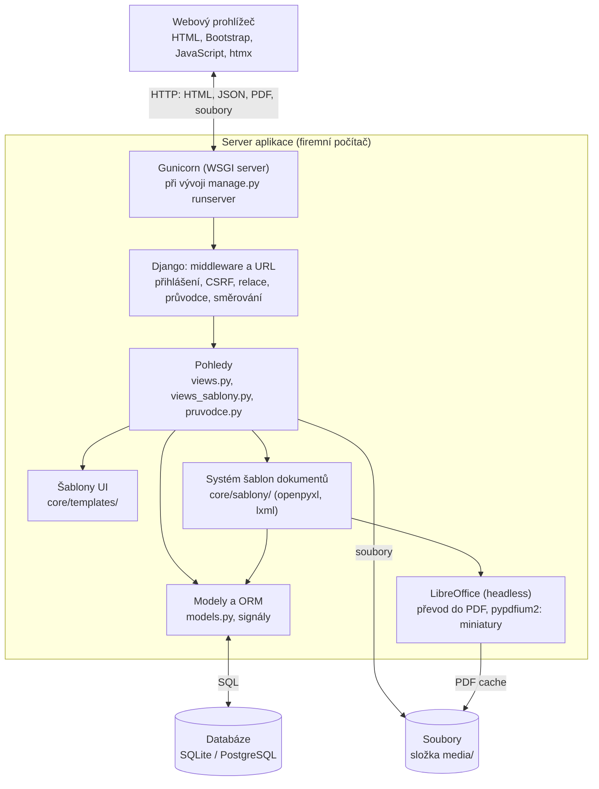
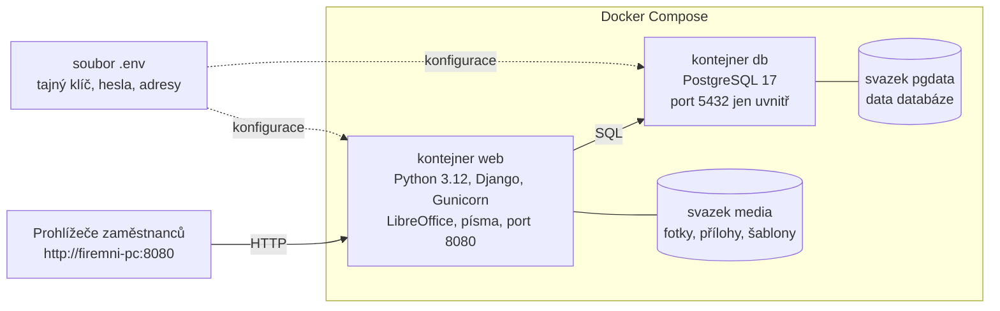

# Architektura aplikace

BusinessManager je webová aplikace s architekturou *klient–server*. Klientem je webový prohlížeč zaměstnance, serverem je aplikace Django běžící na firemním počítači. Serverová část je dále rozdělena do vrstev: vrstvy pro zpracování požadavků (pohledy), vrstvy doménového modelu a přístupu k datům (modely a ORM) a datové vrstvy (databáze a úložiště souborů). Samostatným subsystémem, na který se pohledy obracejí při tvorbě dokumentů, je systém šablon, jenž pro převod do PDF využívá externí program LibreOffice. Celkové uspořádání ukazuje diagram.

*Architektura aplikace BusinessManager*

## Frontend

Frontend tvoří HTML stránky, které generuje server ze šablon Django a posílá je prohlížeči. Nejde tedy o samostatnou klientskou aplikaci (tzv. *single-page application*), ale o klasickou serverově vykreslovanou webovou aplikaci: každé kliknutí na odkaz nebo odeslání formuláře je běžný požadavek HTTP a server odpoví novou stránkou. Tento přístup byl zvolen, protože je jednoduchý, spolehlivý a celá logika aplikace zůstává na jednom místě.

Vzhled stránek zajišťuje framework Bootstrap (přibalený v `core/static/vendor/`, aplikace tedy nic nenačítá z internetu), společné rozvržení definuje šablona `core/templates/core/base.html`. Ta obsahuje horní lištu s přihlášeným uživatelem, levou nabídku s hlavními sekcemi aplikace (lištu lze zasunout tak, že zobrazuje jen ikony, a její stav si prohlížeč pamatuje), přepínač světlého a tmavého režimu), drobečkovou navigaci, zprávy o výsledku akcí a skript vyhledávacích polí s našeptávačem. Jednotlivé obrazovky tuto šablonu rozšiřují o vlastní obsah. Interaktivní prvky, jako je prohlížeč dokumentů nebo editor šablon, jsou napsány v čistém JavaScriptu přímo v příslušných šablonách a data dostávají od serveru vložená do stránky ve formátu JSON (filtr `json_script`).

## Backend

Backend je projekt Django složený ze dvou částí: konfigurace projektu ve složce `config/` a aplikace `core/`, která obsahuje veškerou funkcionalitu. Zpracování každého požadavku probíhá stejně:

1.  Gunicorn přijme požadavek HTTP a předá ho aplikaci Django přes rozhraní WSGI (`config/wsgi.py`).

2.  Požadavek projde řetězcem *middleware*: kontrolou bezpečnosti, obsluhou statických souborů (WhiteNoise), načtením relace, ochranou proti CSRF, průvodcem prvním spuštěním (`PrvniSpusteniMiddleware` přesměruje na průvodce, dokud chybí účet administrátora nebo firma), ověřením přihlášení (`LoginRequiredMiddleware` přesměruje nepřihlášeného uživatele na přihlašovací stránku), zprávami pro uživatele a zápisem navštívené stránky pro tlačítka Zpět a Zrušit (`StopaMiddleware`).

3.  URL směrování (`config/urls.py`, `core/urls.py`) podle adresy vybere pohled.

4.  Pohled načte potřebná data přes ORM, provede požadovanou akci (uložení formuláře, změnu stavu, vytvoření dokladu) a vrátí odpověď: HTML stránku vykreslenou ze šablony, data JSON nebo soubor.

Pohledy jsou rozděleny do dvou modulů. Modul `core/views.py` obsahuje evidenční část aplikace. Velká část tabulek (například katalogy, sazby DPH, platby nebo kontaktní osoby) nemá vlastní obrazovky, ale obsluhují ji *obecné pohledy* `lst`, `detail`, `edit` a `delete`, které podle názvu modelu v adrese (např. `/material/`, `/material/5/upravit/`) zobrazí seznam, detail nebo formulář libovolné tabulky. Formulář se vytvoří automaticky z definice modelu. Pro hlavní agendy, kde obecné zobrazení nestačí, obsahuje modul specializované pohledy: formulář nové zakázky, pracovní plochu zakázky, přehled zařízení, detail zákazníka, tvorbu nabídky, faktury a přijaté objednávky ze zakázky, přijaté faktury, kalendář, nastavení (včetně číslování dokladů) a řízení stavů zakázky. Modul `core/pruvodce.py` obsahuje průvodce prvním spuštěním. Modul `core/views_sablony.py` obsahuje správu šablon dokumentů, náhled dokumentu, výběr šablony, export do PDF a editor šablon.

Doménová logika, která musí platit bez ohledu na to, odkud se data mění, je umístěna přímo v modelech (`core/models.py`): přidělování čísel zakázek, nabídek a faktur podle číselných řad (`core/cislovani.py`), výpočet ceny položek a součtů dokladu, uložení kopie údajů zákazníka do dokladu, kopírování ceny materiálu při jeho použití a zajištění, že v každém typu dokumentu je výchozí právě jedna šablona. Vedlejší účinky, jako je zápis událostí do kalendáře, zajišťují signály `post_save`. Každou změnu dat provedenou uživatelem zapisuje pohled funkcí `log` do tabulky historie změn.

## Databáze

Datová vrstva je relační databáze, ke které aplikace přistupuje výhradně přes ORM frameworku Django. Pohledy a modely tak pracují s objekty jazyka Python (např. `Zakazka.objects.filter(…)`) a Django je převádí na dotazy SQL pro konkrétní databázový systém. Díky tomu lze stejný kód provozovat nad SQLite (vývoj, provoz bez Dockeru) i nad PostgreSQL (provoz v Dockeru). Operace, které mění více tabulek najednou (založení zakázky se zařízeními, fotografiemi, pracemi a materiálem, vytvoření dokladu s položkami), probíhají v databázové transakci (`transaction.atomic`), takže se buď uloží celé, nebo vůbec. Podrobně je databáze popsána v kapitole [Databáze](07-databaze.md).

## Práce se soubory

Soubory, které uživatelé do aplikace nahrávají, se neukládají do databáze, ale do složky `media` (nastavení `MEDIA_ROOT`). Databáze obsahuje pouze relativní cestu k souboru. Soubory jsou ve složce rozděleny podle druhu a u fotografií a příloh také podle roku a měsíce nahrání, aby jedna složka neobsahovala tisíce souborů:

| **Složka**               | **Obsah**                                                           |
|:-------------------------|:--------------------------------------------------------------------|
| `media/fotky/RRRR/MM/`   | fotografie zakázek (tabulka Fotografie)                             |
| `media/prilohy/RRRR/MM/` | přílohy zakázek a objednávek, např. PDF dokumenty (tabulka Příloha) |
| `media/prijate_faktury/RRRR/` | původní soubory přijatých faktur (ISDOC, PDF) |
| `media/logo/`            | logo firmy vkládané do dokumentů                                    |
| `media/sablony/`         | nahrané a v editoru upravené soubory šablon dokumentů               |
| `media/sablony/nahledy/` | miniatury šablon ve formátu PNG                                     |
| `media/cache/dokumenty/` | vyrovnávací paměť vytvořených PDF                                   |

*Složky pro ukládání souborů*

Soubory ze složky `media` obsluhuje přímo Django pohledem `serve`, který je stejně jako ostatní stránky chráněn přihlášením. Fotografie zákazníků a jejich dokumenty tak nejsou dostupné nikomu, kdo není do aplikace přihlášen. Aby bylo možné dokumenty zobrazovat v prohlížeči dokumentů uvnitř aplikace (v prvku `iframe`), je povoleno vkládání stránek pouze v rámci stejné aplikace (`X_FRAME_OPTIONS = "SAMEORIGIN"`).

## Generování dokumentů

Generování dokumentů je samostatný subsystém ve složce `core/sablony/`, který je rozdělen do tří nezávislých vrstev:

- **Typy dokumentů** (`typy.py`) vědí, *jaká data* dokument obsahuje. Každý typ (zakázkový list, cenová nabídka, faktura) definuje katalog polí, která lze do šablony vložit, a umí z objektu v databázi sestavit data dokumentu ve standardizovaném tvaru.

- **Renderery** (`renderery.py`) vědí, *jak* se z šablony a dat vytvoří výsledek. Existuje renderer pro Excelové šablony a renderer pro HTML šablony; oba mají stejné rozhraní (`analyzuj`, `nahled`, `pdf`).

- **Uložená šablona** (model `SablonaDokumentu`) určuje *vzhled*: obsahuje soubor šablony a mapování polí na buňky, ale žádná data.

Pomocné moduly `excel.py`, `kresby.py` a `prevod.py` obsahují práci s Excelem, zachování kreseb a převod do PDF přes LibreOffice. Díky oddělení vrstev lze přidat nový typ dokumentu (třída v `typy.py`) nebo nový formát šablon (třída v `renderery.py`), aniž by bylo nutné měnit zbytek aplikace. Systém je podrobně popsán v kapitole [Šablony dokumentů](08-sablony-dokumentu.md).

## Komunikace jednotlivých komponent

Jednotlivé části aplikace spolu komunikují několika způsoby:

- **Prohlížeč a server** komunikují protokolem HTTP. Běžné stránky a formuláře používají metody GET a POST s klasickým znovunačtením stránky. Vyhledávací pole s našeptávačem volá adresu `/lookup/<typ>/?q=...` a dostává odpověď ve formátu JSON, nový záznam zakládá odesláním formuláře z dialogového okna. Editor šablon odesílá provedené změny jako dokument JSON metodou POST. Náhled položek nabídky a faktury načítá knihovna htmx jako fragment HTML.

- **Náhled dokumentu** je stránka, která obsahuje prvek `iframe`. Ten načítá samotný obsah dokumentu z adresy `/dokument/<typ>/<id>/obsah/` jako HTML nebo PDF, takže se dokument zobrazí přímo v aplikaci.

- **Pohledy a modely** komunikují voláním metod ORM; modely na změny reagují signály (např. vznik faktury vyvolá vytvoření události v kalendáři).

- **Systém šablon a LibreOffice** komunikují přes soubory: renderer uloží vyplněný sešit do dočasné složky, spustí LibreOffice jako samostatný proces (`subprocess`) a načte vytvořené PDF.

- **Django a databáze** komunikují jazykem SQL přes databázový ovladač (vestavěný modul `sqlite3`, resp. `psycopg` pro PostgreSQL).

## Zabezpečení

Aplikace pracuje s osobními a obchodními údaji zákazníků, proto obsahuje několik bezpečnostních opatření. Všechny stránky i soubory jsou dostupné pouze přihlášeným uživatelům. Formuláře jsou chráněny proti útoku CSRF, výstupy šablon jsou automaticky ošetřeny proti vložení kódu (XSS) a databázové dotazy se díky ORM skládají bezpečně. Nastavení (údaje o firmě, DPH, zaměstnanci a role, katalogy, číslování dokladů, historie změn, zálohování) vidí a mění jen administrátor, tedy uživatel s příznakem *Staff* nebo *Superuser*; šablony dokumentů může upravovat každý přihlášený uživatel. Ruční změna stavu zakázky mimo běžný pracovní postup je povolena jen uživatelům s rolí administrátora nebo s oprávněním `zakazky.zmenit_stav`. Odolnost proti útoku SQL injection ověřují automatické testy (viz [Testování](09-vyvoj-a-testovani.md)). Záznamy, na které navazuje historie (zákazníci, zařízení, materiál apod.), se nemažou, ale pouze deaktivují, a databáze zabraňuje smazání záznamu, na který odkazují jiné záznamy. Citlivé údaje konfigurace (tajný klíč aplikace, hesla k databázi, povolené adresy serveru) se nezapisují do zdrojového kódu, ale načítají se z proměnných prostředí v souboru `.env`.

## Spuštění a zabalení aplikace

Aplikaci lze spustit dvěma způsoby, které odpovídají dvěma situacím, v nichž se používá.

### Provoz ve firmě (Docker)

Pro nasazení na firemní počítač je aplikace zabalena do kontejnerů Docker (diagram níže). Obraz aplikace se sestavuje podle souboru `Dockerfile`: vychází z obrazu `python:3.12-slim`, doinstaluje LibreOffice bez grafického rozhraní a písma kompatibilní s Arial a Calibri (aby PDF vypadalo stejně jako v Excelu), nainstaluje knihovny ze souboru `requirements.txt` a zkopíruje zdrojový kód. Při každém spuštění kontejneru provede skript `docker-entrypoint.sh` tři kroky: aplikuje migrace databáze (`migrate`), připraví statické soubory (`collectstatic`) a spustí server Gunicorn na portu 8080. Soubor `docker-compose.yml` k aplikaci přidává kontejner s databází PostgreSQL 17, na jehož připravenost kontejner aplikace čeká (`healthcheck`). Port databáze se záměrně nepublikuje mimo Docker, takže databáze je dostupná jen aplikaci.

Ve Windows instalaci zajistí dvojklik na `instalace.bat`: skript vytvoří soubor `.env` s náhodnými hesly, spustí `docker compose up -d --build` a otevře prohlížeč. Ručně stačí zkopírovat `.env.example` na `.env`, vyplnit hesla a adresy a spustit `docker compose up -d --build`. Postup krok za krokem je v [INSTALACE.md](../INSTALACE.md). Aktualizaci na novou verzi ve Windows provede dvojklik na `aktualizace.bat`: skript vytvoří zálohu, stáhne nejnovější verzi z GitHubu, přepíše jí soubory aplikace (soubor `.env` a data zůstanou) a spustí `docker compose up -d --build`. Ručně se aplikace aktualizuje příkazy `git pull` a `docker compose up -d --build`. Migrace databáze proběhnou v obou případech automaticky. Data jsou uložena ve svazcích `pgdata` (databáze) a `media` (soubory), takže přežijí restart počítače i aktualizaci aplikace. Zálohu databáze i souborů vytvoří `zaloha.bat` (uvnitř volá `pg_dump` a zkopíruje svazek `media`); ruční postup a obnova jsou v [INSTALACE.md](../INSTALACE.md) i přímo v aplikaci (Nastavení → Systém → Zálohování).

*Nasazení aplikace pomocí Docker Compose*

### Vývoj a provoz bez Dockeru

Při vývoji se aplikace spouští přímo: ve virtuálním prostředí jazyka Python se nainstalují knihovny (`pip install -r requirements.txt`), vytvoří se databáze (`python manage.py migrate`) a spustí vývojový server (`python manage.py runserver 8080`). V tomto režimu se používá databáze SQLite v souboru `db.sqlite3` a pro tvorbu PDF je potřeba mít v počítači nainstalovaný LibreOffice. Pokud LibreOffice chybí, aplikace na to uživatele upozorní a nabídne použití HTML šablon, jejichž náhled se zobrazí i bez něj.

### Inicializace dat

Po každém spuštění migrací se automaticky (signál `post_migrate` v `core/apps.py`) vytvoří chybějící výchozí data: stavy zakázek v pořadí pracovního postupu, oprávnění pro ruční změnu stavu, sazby DPH 21 %, 12 % a 0 % a vestavěné šablony dokumentů pro každý typ dokumentu (Excelová „firemní“ a „standardní“ a HTML „jednoduchá“). Údaje o firmě se automaticky nezakládají, vyplní je administrátor v průvodci prvním spuštěním. Databáze je po instalaci jinak prázdná. Pro vývoj a předvádění slouží příkaz `python manage.py seed_data`, který vytvoří testovací zákazníky, zařízení, zakázky, zaměstnance, práce a materiál.
