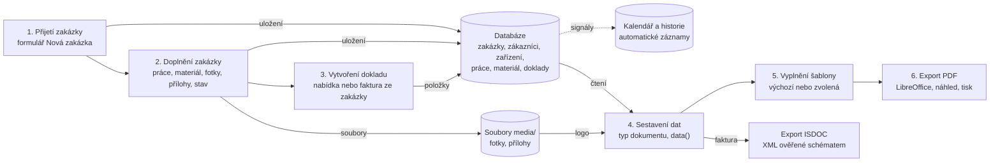

# Tok dat aplikací

Ostatní kapitoly popisují jednotlivé součásti aplikace samostatně. Tato kapitola je propojuje a sleduje, jak data procházejí celým systémem od okamžiku, kdy je uživatel zadá, až po vytvoření výsledného dokumentu. Tok dat znázorňuje diagram; jednotlivé kroky jsou popsány v následujícím textu.

*Tok dat od zadání zakázky po výsledný dokument*

## Krok 1: zadání údajů a uložení zakázky

Data vstupují do systému převážně formulářem nové zakázky. Prohlížeč odešle formulář metodou POST jako `multipart/form-data`, protože obsahuje i fotografie. Jednotlivé údaje přicházejí jako textové hodnoty (identifikátory vybraných záznamů, texty, čísla zapsaná s desetinnou čárkou), které pohled `zakazka_nova` převede na správné typy: identifikátory na odkazy na záznamy, ceny na typ `Decimal` (s nahrazením čárky tečkou), datum přijetí na datum a čas s časovým pásmem.

Zákazník, zařízení, kontaktní osoba a materiál se do formuláře nedostávají jako text, ale jako odkazy na existující záznamy. Pokud záznam neexistoval, uživatel ho založil v dialogovém okně ještě před odesláním formuláře; tím vznikl samostatný záznam v databázi a do formuláře se vrátil jen jeho identifikátor. Díky tomu se stejný zákazník nebo zařízení neukládá vícekrát.

Pohled pak v jedné transakci uloží zakázku a všechny navázané záznamy (vazby na zařízení a zaměstnance, kontaktní osobu, fotografie, práce, materiál). Fotografie se uloží do složky `media/fotky/` a do databáze jen cesta k nim. Uložení zakázky vyvolá signál, který zapíše událost do kalendáře, a pohled zapíše záznam do historie změn.

## Krok 2: doplňování zakázky během opravy

Během opravy se k zakázce postupně přidávají další data: provedené práce s cenou, sazbou DPH a pracovníky, použitý materiál s množstvím a cenou převzatou z katalogu, další fotografie a přílohy, objednávka zákazníka a změny stavu. Každý z těchto údajů je samostatný záznam v databázi s cizím klíčem na zakázku. Při změně stavu „Vydáno“ se do zakázky zapíše datum vydání a do kalendáře událost vydání. Všechny změny se zaznamenají do historie změn.

V tomto okamžiku jsou v databázi uložena všechna *zdrojová data*, ze kterých se odvozují výstupy: kdo je zákazník, které zařízení se opravovalo, co se na něm dělalo, co se spotřebovalo a kolik to stálo.

## Krok 3: vytvoření nabídky nebo faktury

Při vytvoření nabídky nebo faktury se zdrojová data zakázky převedou na *data dokladu*. Funkce `nabidka_polozky` přečte práce a materiál zakázky a vytvoří z nich položky (popis, množství, jednotka, jednotková cena, sazba DPH). Pohled vytvoří záznam dokladu, do kterého zkopíruje údaje zákazníka a identifikační čísla zakázky, a uloží položky. Při uložení každé položky model dopočítá její cenu bez DPH a s DPH a aktualizuje součty dokladu. Číslo dokladu přidělí model podle číselné řady (viz [Číslování dokladů](02-funkce.md#číslování-dokladů)). U faktury se zároveň založí platba ve stavu „Čeká na zaplacení“.

Tento krok je místem, kde se data „zamrazí“. Doklad od této chvíle obsahuje vlastní kopii položek a údajů zákazníka. Pozdější úpravy zakázky nebo zákazníka vystavený doklad nezmění, což odpovídá požadavku, aby doklad zůstal ve stavu, v jakém byl vystaven. Zakázkový list naproti tomu vlastní kopii nemá a vždy zobrazuje aktuální stav zakázky.

## Krok 4: sestavení dat dokumentu

Při zobrazení dokumentu se nejprve určí typ dokumentu (zakázkový list, nabídka, faktura) a načte se objekt z databáze. Metoda `data()` typu dokumentu z něj sestaví data ve standardizovaném tvaru (ukázka v kapitole [Šablony dokumentů](08-sablony-dokumentu.md#typy-dokumentů-a-katalog-polí)): slovník jednoduchých polí a seznamy položek, materiálu a prací. Při tom se data obohatí o údaje, které nejsou uloženy přímo v dokladu: údaje o firmě z nastavení (včetně cesty k logu), údaje o zakázce a zařízení přes vazbu dokladu na zakázku, odvozené hodnoty (pořadové číslo, variabilní symbol, ulice a město z adresy, součty) a seznamy prací s pracovníky. Výsledek je nezávislý na tom, jaká šablona se použije.

## Krok 5: vložení údajů do šablony

Aplikace vybere šablonu: buď tu, kterou uživatel zvolil v náhledu, nebo výchozí šablonu daného typu. Renderer Excelové šablony načte soubor šablony a její mapování, vyplní tabulky (s vložením potřebného počtu řádků), nahradí značky hodnotami ve správném formátu, vloží logo a obnoví tvary z původního souboru. Výsledkem je nový soubor `.xlsx`, který existuje jen dočasně. Renderer HTML šablony vykreslí šablonu Django s daty dokumentu.

## Krok 6: export dokumentu do PDF a ISDOC

Vyplněný soubor převede LibreOffice na PDF, které se uloží do vyrovnávací paměti a odešle prohlížeči. Uživatel ho vidí v náhledu, může ho vytisknout nebo stáhnout pod názvem podle firemních zvyklostí. Stejný dokument je dostupný i v prohlížeči dokumentů na pracovní ploše zakázky. Protože klíč vyrovnávací paměti obsahuje všechna data dokumentu, jakákoli změna v databázi se při dalším zobrazení projeví novým PDF.

U faktury je k dispozici ještě druhý výstup, elektronická faktura ve formátu ISDOC. Ten navazuje přímo na krok 4 a kroky 5 a 6 vynechává: data dokumentu se místo do šablony převedou rovnou do dokumentu XML, který se ověří proti schématu formátu a odešle ke stažení (viz část [Export do formátu ISDOC](08-sablony-dokumentu.md#export-do-formátu-isdoc)). PDF i ISDOC tak vznikají ze stejných dat a nemohou si odporovat.

## Tok dat přijatých faktur

Přijaté faktury od dodavatelů procházejí aplikací opačným směrem než vystavené doklady. Data nevznikají v aplikaci, ale přicházejí zvenčí v souboru ISDOC. Funkce `nacti` z něj přečte údaje faktury a dodavatele (část [Import přijatých faktur](08-sablony-dokumentu.md#import-přijatých-faktur-ve-formátu-isdoc)), pohled je porovná s evidencí dodavatelů a přijatých faktur, aby nevznikly duplicity, a uloží záznam faktury spolu s původním souborem. Uložení vyvolá signál, který zapíše doručení a splatnost do kalendáře. Když uživatel fakturu označí jako zaplacenou, signál stejné události aktualizuje a přidá událost zaplacení. Přijatá faktura tak nevstupuje do šablon dokumentů; jejím výstupem je přehled závazků v seznamu dokumentů a v kalendáři.

## Shrnutí toku dat

Z popsaného toku vyplývají tři vlastnosti, na kterých stojí návrh celé aplikace:

- **Jedno místo zadání.** Každý údaj (zákazník, zařízení, cena materiálu) se zadá jednou a dále se na něj jen odkazuje. Všechny výstupy z něj vznikají automaticky.

- **Jasný okamžik zamrazení.** Zdrojová data zakázky se mohou měnit až do vytvoření dokladu. Doklad si uloží vlastní kopii položek a údajů zákazníka, a je proto neměnný.

- **Dokument je pohled na data.** Výsledné dokumenty se neukládají, ale vždy se sestaví z databáze a šablony. Změna šablony změní vzhled všech dokumentů, nikoli jejich obsah; oprava dat se projeví ve všech dokumentech, které se z nich znovu vytvoří.
