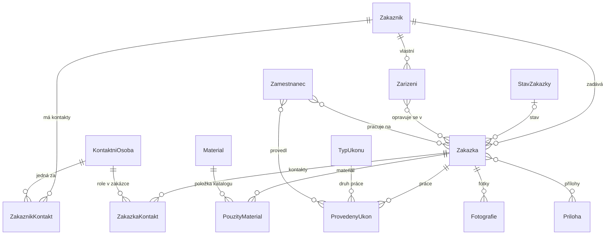
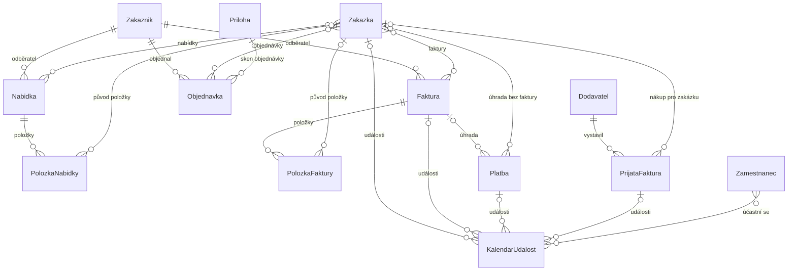
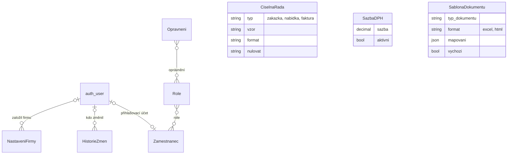

# Databáze

## Databázový systém a jeho role v aplikaci

### Použitý databázový systém

Aplikace ukládá data do relační databáze. Podporovány jsou dva databázové systémy: **SQLite** a **PostgreSQL 17**. SQLite je souborová databáze, která nepotřebuje žádný server a celá je uložena v souboru `db.sqlite3`; používá se při vývoji a při spuštění aplikace bez Dockeru. PostgreSQL je databázový server, který se používá při provozu ve firmě, kde aplikace běží v kontejnerech Docker. Volba systému se provádí proměnnou prostředí `DB_ENGINE` v konfiguraci `config/settings.py`; zdrojový kód aplikace je pro oba systémy stejný.

### Důvody volby

Relační databáze byla zvolena proto, že data aplikace mají pevnou strukturu a jsou navzájem silně provázaná: zakázka patří zákazníkovi, obsahuje zařízení tohoto zákazníka, na zakázku navazují práce, materiál, doklady a platby. Relační model umožňuje tyto vazby vyjádřit cizími klíči a nechat databázi hlídat jejich platnost, takže nemůže vzniknout například zakázka bez zákazníka nebo položka faktury bez faktury.

SQLite byl zvolen pro jednoduchost: nevyžaduje instalaci ani správu a pro jednoho vývojáře nebo jeden počítač je zcela dostačující. PostgreSQL byl zvolen pro provoz, protože spolehlivě zvládá současnou práci více zaměstnanců, důsledně kontroluje datové typy a délky textů a nabízí standardní nástroje pro zálohování a obnovu (`pg_dump`, `psql`). Oba systémy jsou zdarma a podporované frameworkem Django bez dalších úprav kódu.

### Úloha databáze v aplikaci

Databáze je jediným místem, kde jsou uložena data aplikace. Obsahuje evidenci zákazníků, zařízení a zakázek, záznamy o provedené práci a použitém materiálu, vystavené doklady, platby, události kalendáře, historii změn, číselníky (stavy zakázek, typy úkonů, materiál, sazby DPH), údaje o firmě a definice šablon dokumentů. Soubory (fotografie, přílohy, soubory šablon, logo) se v databázi neukládají; databáze obsahuje jen jejich relativní cestu ve složce `media`. Výsledné dokumenty se také neukládají, ale vždy se sestavují z aktuálních dat.

### Způsob používání databáze aplikací

Aplikace s databází pracuje výhradně prostřednictvím ORM frameworku Django. Každá tabulka je popsána třídou (modelem) v souboru `core/models.py`, každý sloupec atributem této třídy. Z těchto definic Django vytváří *migrace*, tedy skripty, které databázové schéma vytvoří nebo upraví. Při práci s daty používá aplikace metody ORM (`create`, `filter`, `select_related`, `annotate`, …) a Django je převádí na dotazy SQL. Pro implementaci databáze jsou důležité tyto konvence:

- **Názvy tabulek** se tvoří z názvu aplikace a modelu, například model `Zakazka` je uložen v tabulce `core_zakazka`. V dalším textu jsou tabulky označovány názvem modelu.

- **Primární klíč** má každá tabulka automaticky ve sloupci `id` (celé číslo s automatickým zvyšováním, typ `BigAutoField`).

- **Cizí klíč** se ukládá do sloupce s příponou `_id`, například `zakaznik_id`. U každého cizího klíče je určeno chování při smazání odkazovaného záznamu: `PROTECT` smazání zakáže (např. nelze smazat zákazníka, který má zakázky), `CASCADE` smaže i závislé záznamy (např. položky smazané faktury) a `SET_NULL` odkaz vynuluje. Toto chování provádí Django před odesláním příkazu do databáze; databáze sama hlídá, aby cizí klíč neodkazoval na neexistující záznam.

- **Vazby M:N** (mnoho ku mnoha) Django realizuje vazební tabulkou se dvěma cizími klíči, například tabulka `core_zakazka_zarizeni` propojuje zakázky a zařízení.

- **Peněžní částky** se ukládají jako desetinná čísla s pevnou přesností (`DecimalField`, 12 číslic, z toho 2 desetinná místa) a počítá se s nimi typem `Decimal`, aby nevznikaly zaokrouhlovací chyby.

- **Datum a čas** se ukládá v UTC a do českého času se převádí až při zobrazení (`USE_TZ = True`, časové pásmo `Europe/Prague`).

- **Deaktivace místo mazání**: tabulky číselníků a evidence (zákazníci, zařízení, materiál, …) mají sloupec `aktivni`. Smazání takového záznamu v aplikaci znamená jen jeho deaktivaci, takže historické zakázky a doklady zůstávají úplné.

- **Validace**: formát IČO (8 číslic a kontrolní součet), DIČ a telefonu se kontroluje validátory v modelu ještě před uložením do databáze.

- **Integritní omezení v databázi**: kromě primárních a cizích klíčů obsahuje schéma omezení `UNIQUE` a `CHECK`, například povolené hodnoty výčtových sloupců, rozsah sazby DPH nebo povinné jméno či firmu zákazníka. Úplný seznam omezení je v [referenčním přehledu tabulek](databaze-tabulky.md). Formuláře tato omezení kontrolují už před uložením a zobrazí srozumitelné hlášení.

## Schéma databáze

Databáze obsahuje 30 tabulek aplikace a 10 vazebních tabulek pro vazby M:N. Navíc aplikace využívá tabulku uživatelských účtů `auth_user` frameworku Django. Pro přehlednost je schéma rozděleno do tří diagramů: jádro databáze (zakázka a tabulky, které ji popisují), doklady s platbami, přijatými fakturami a kalendářem a nakonec uživatelé, oprávnění a samostatné tabulky nastavení. Značky na koncích spojnic udávají kardinalitu vazby (`||` právě jeden, `|o` nejvýše jeden, `o{` libovolně mnoho; `}o--o{` je vazba M:N).

Všechny sloupce včetně datových typů a integritních omezení jsou v [referenčním přehledu tabulek](databaze-tabulky.md), který se generuje přímo z modelů. Diagramy se na GitHubu vykreslí automaticky (formát Mermaid).

*Zakázka a navázané tabulky*

*Doklady, platby, přijaté faktury a kalendář*

*Uživatelé, oprávnění a nastavení. Na `auth_user` dále odkazují sloupce, které zaznamenávají autora (např. `vystavil_id` u faktury, `nahral_id` u fotografie).*

## Popis jednotlivých tabulek

V této části jsou popsány všechny tabulky aplikace, seskupené podle oblasti, kterou v aplikaci pokrývají. U každé tabulky je uveden její účel, význam důležitých sloupců, klíče a vazby na ostatní tabulky. Sloupec `id` (primární klíč) má každá tabulka a v přehledech sloupců je uveden jen tam, kde to pomáhá porozumění. Zkratka PK označuje primární klíč, FK cizí klíč.

### Zákazníci a kontaktní osoby

#### Zakaznik

Tabulka `core_zakaznik` eviduje zákazníky firmy, a to firmy i soukromé osoby. Je jednou ze základních tabulek celé aplikace: odkazují na ni zařízení, zakázky, nabídky, objednávky i faktury. Bez ní by nebylo možné určit, komu zařízení patří a komu se vystavuje doklad. Údaje zákazníka se vkládají do všech dokumentů. Zákazníka lze založit v evidenci zákazníků nebo přímo při přijetí zakázky.

| **Sloupec**        | **Datový typ**      | **Význam**                                                                                                                                              |
|:-------------------|:--------------------|:--------------------------------------------------------------------------------------------------------------------------------------------------------|
| `id`               | celé číslo, PK      | identifikátor zákazníka                                                                                                                                 |
| `typ_zakaznika`    | text (20)           | „Firma“ nebo „Soukromá osoba“; v seznamu se zobrazuje zkratkou F/SO; jiné hodnoty nepovolí omezení `CHECK`; zákazník musí mít vyplněné jméno nebo firmu |
| `jmeno`            | text (150)          | jméno soukromé osoby nebo kontaktní osoby firmy                                                                                                         |
| `firma`            | text (255)          | obchodní název firmy                                                                                                                                    |
| `adresa`           | text (200)          | adresa; v dokumentech se dělí na ulici a PSČ s městem                                                                                                   |
| `telefon`, `email` | text                | kontaktní údaje (telefon s kontrolou formátu)                                                                                                           |
| `ico`, `dic`       | text (8), text (14) | IČO s kontrolou kontrolního součtu, DIČ ve tvaru CZ12345678                                                                                             |
| `aktivni`          | logická hodnota     | neaktivní zákazník se nenabízí při výběru                                                                                                               |
| `datum_vytvoreni`  | datum a čas         | kdy byl záznam založen                                                                                                                                  |

*Důležité sloupce tabulky Zakaznik*

Tabulka nemá cizí klíče. Vazby: 1:N na Zarizeni, Zakazka, Nabidka, Faktura a Objednavka (všechny s ochranou `PROTECT`), 1:N na ZakaznikKontakt.

#### KontaktniOsoba

Tabulka `core_kontaktniosoba` eviduje konkrétní osoby, se kterými firma jedná, například zaměstnance zákaznické firmy, kteří zařízení přinesli nebo vyzvedli. Samostatná tabulka je potřebná proto, že jedna firma může mít více kontaktních osob a jedna osoba může jednat za více zákazníků. Sloupce: `jmeno` (text 150, celé jméno), `telefon`, `email`, `poznamka` a `aktivni`. Tabulka nemá cizí klíče; se zákazníky a zakázkami je spojena přes tabulky ZakaznikKontakt a ZakazkaKontakt.

#### ZakaznikKontakt

Tabulka `core_zakaznikkontakt` je vazební tabulka mezi zákazníkem a kontaktní osobou, která navíc nese poznámku k této vazbě (např. funkci osoby u zákazníka). Obsahuje cizí klíče `zakaznik_id` → Zakaznik a `kontakt_id` → KontaktniOsoba (oba `CASCADE`) a sloupec `poznamka`. Dvojice (`zakaznik_id`, `kontakt_id`) je unikátní, takže stejná osoba nemůže být u zákazníka uvedena dvakrát. Díky ní nabízí formulář přijetí zakázky po výběru zákazníka jen jeho kontaktní osoby. Záznam vzniká automaticky, když je kontaktní osoba použita v zakázce daného zákazníka.

### Zařízení

#### Zarizeni

Tabulka `core_zarizeni` eviduje zařízení zákazníků (elektromotory, nářadí a další stroje), která firma opravuje. Tabulka je potřebná, protože totéž zařízení se do firmy může vracet opakovaně a u každého zařízení je potřeba znát historii všech oprav. Zařízení se proto zakládá jen jednou a k dalším zakázkám se pouze připojuje.

| **Sloupec**                  | **Datový typ**            | **Význam**                                           |
|:-----------------------------|:--------------------------|:-----------------------------------------------------|
| `zakaznik_id`                | FK → Zakaznik | vlastník zařízení (`PROTECT`)                        |
| `vyrobce`                    | text (100)                | výrobce (značka) zařízení                            |
| `typ`                        | text (100)                | typ nebo model                                       |
| `seriove_cislo`              | text (100), index         | výrobní číslo; indexováno kvůli rychlému vyhledávání |
| `popis`                      | dlouhý text               | další popis, příslušenství                           |
| `aktivni`, `datum_vytvoreni` |                           | deaktivace a datum založení                          |

*Důležité sloupce tabulky Zarizeni*

Vazby: N:1 na Zakaznik, M:N na Zakazka (vazební tabulka `core_zakazka_zarizeni`). Aplikace při zakládání kontroluje, zda zákazník již nemá zařízení se stejným sériovým číslem, aby nevznikaly duplicity. Stav zařízení (ve firmě, u zákazníka, čeká na díl) se neukládá, ale odvozuje se ze stavu jeho poslední zakázky.

### Zakázky

#### Zakazka

Tabulka `core_zakazka` je ústřední tabulkou aplikace. Každý záznam představuje jednu servisní zakázku, tedy jedno přijetí zařízení (nebo více zařízení) k opravě. Na zakázku se váže téměř vše ostatní: práce, materiál, fotografie, přílohy, kontakty, doklady, platby i události kalendáře.

| **Sloupec**                               | **Datový typ**               | **Význam**                                                                                                                      |
|:------------------------------------------|:-----------------------------|:--------------------------------------------------------------------------------------------------------------------------------|
| `id`                                      | celé číslo, PK               | identifikátor zakázky                                                                                                           |
| `cislo_zakazky`                           | text (50), unikátní          | číslo zakázky podle číselné řady (výchozí tvar `RRRR-NNN`, např. 2026-048); při prázdné hodnotě se přidělí automaticky |
| `zakaznik_id`                             | FK → Zakaznik    | zákazník (`PROTECT`)                                                                                                            |
| `stav_id`                                 | FK → StavZakazky | aktuální stav zakázky                                                                                                           |
| `datum_prijeti`                           | datum a čas                  | kdy bylo zařízení přijato                                                                                                       |
| `datum_vydani`                            | datum a čas                  | kdy bylo zařízení vydáno zákazníkovi (nastavuje se automaticky akcí Vydat)                                                      |
| `identifikacni_cislo`, `sekundarni_cislo` | text (50), index             | čísla zakázky u zákazníka (např. inventární nebo objednací číslo)                                                               |
| `popis_zavady`                            | dlouhý text                  | popis závady uvedený zákazníkem                                                                                                 |
| `poznamka`                                | dlouhý text                  | interní poznámka                                                                                                                |
| `poradi`                                  | celé kladné číslo            | pořadové číslo vyčtené z čísla zakázky; přebírá ho nabídka                                                                      |
| `datum_vytvoreni`, `datum_upravy`         | datum a čas                  | založení a poslední změna záznamu                                                                                               |

*Důležité sloupce tabulky Zakazka*

Vazby: N:1 na Zakaznik a StavZakazky; M:N na Zarizeni a Zamestnanec (vazební tabulky `core_zakazka_zarizeni` a `core_zakazka_zamestnanci`); 1:N na ZakazkaKontakt, ProvedenyUkon, PouzityMaterial, Fotografie, Platba a KalendarUdalost; M:N na Priloha, Nabidka, Faktura a Objednavka. Při vytvoření nové zakázky se signálem automaticky vytvoří událost kalendáře „Přijetí zakázky“; při změně data přijetí se událost posune.

#### StavZakazky

Tabulka `core_stavzakazky` je číselník stavů, kterými zakázka prochází. Sloupce: `nazev` (text 100), `popis`, `poradi` (celé číslo určující pořadí zobrazení), `aktivni` a `datum_vytvoreni`. Výchozí stavy se vytvoří při instalaci: Nová, Rozpracováno, Čeká na schválení, Čeká na díl, Opraveno, Připraveno k vyzvednutí, Vydáno a Zrušeno. Stavy jsou v samostatné tabulce, a ne jako pevný výčet, aby je bylo možné přejmenovat nebo doplnit bez změny kódu. Pravidla, které přechody mezi stavy jsou povoleny, jsou definována v kódu (část [Funkce aplikace](02-funkce.md)). Vazba 1:N na Zakazka.

#### ZakazkaKontakt

Tabulka `core_zakazkakontakt` zaznamenává, které kontaktní osoby se zakázkou souvisí a v jaké roli. Sloupce: `zakazka_id` → Zakazka a `kontakt_id` → KontaktniOsoba (oba `CASCADE`) a `role` s hodnotami „Přinesl zařízení“, „Vyzvedl zařízení“, „Kontakt“ a „Jiné“ (jiné hodnoty nepovolí omezení `CHECK`); trojice (zakázka, osoba, role) je unikátní. Tabulka je potřebná, protože u firemních zákazníků zařízení často přináší a vyzvedává jiná osoba a firma potřebuje vědět, komu bylo zařízení předáno.

### Práce a materiál

#### TypUkonu

Tabulka `core_typukonu` je číselník druhů prací (např. diagnostika, převinutí motoru, výměna ložisek, servisní práce). Sloupce: `nazev` (text 150), `popis`, `aktivni`, `datum_vytvoreni`. Díky číselníku se práce pojmenovávají jednotně, což je důležité pro text dokladů. Vazba 1:N na ProvedenyUkon (`PROTECT`).

#### ProvedenyUkon

Tabulka `core_provedenyukon` zaznamenává jednotlivé práce provedené na zakázce. Z těchto záznamů se sestavují položky nabídek a faktur i seznam prací v zakázkovém listu.

| **Sloupec**       | **Datový typ**            | **Význam**                                                |
|:------------------|:--------------------------|:----------------------------------------------------------|
| `zakazka_id`      | FK → Zakazka  | zakázka, ke které práce patří (`CASCADE`)                 |
| `typ_ukonu_id`    | FK → TypUkonu | druh práce (`PROTECT`)                                    |
| `cena`            | desetinné (12,2)          | cena práce bez DPH                                        |
| `sazba_dph`       | desetinné (5,2)           | sazba DPH v procentech; prázdná = výchozí sazba firmy     |
| `poznamka`        | dlouhý text               | upřesnění; první řádek se připojí k názvu položky dokladu |
| `datum_vytvoreni` | datum a čas               | kdy byla práce zapsána                                    |

*Důležité sloupce tabulky ProvedenyUkon*

Vazba M:N na Zamestnanec (`core_provedenyukon_zamestnanci`) určuje, kdo práci provedl; tato informace se zobrazuje v zakázkovém listu.

#### Material

Tabulka `core_material` je katalog materiálu a náhradních dílů. Sloupce: `nazev` (text 200), `jednotka` (výchozí „ks“), `posledni_cena` (desetinné 12,2), `aktivni` a `datum_vytvoreni`. Katalog umožňuje vybírat materiál vyhledáváním a automaticky nabízí poslední cenu. Vazba 1:N na PouzityMaterial (`PROTECT`).

#### PouzityMaterial

Tabulka `core_pouzitymaterial` zaznamenává materiál spotřebovaný na zakázce.

| **Sloupec**                 | **Datový typ**            | **Význam**                                 |
|:----------------------------|:--------------------------|:-------------------------------------------|
| `zakazka_id`                | FK → Zakazka  | zakázka (`CASCADE`)                        |
| `material_id`               | FK → Material | položka katalogu (`PROTECT`)               |
| `mnozstvi`                  | desetinné (12,3)          | spotřebované množství v jednotce materiálu |
| `jednotkova_cena`           | desetinné (12,2)          | cena za jednotku v okamžiku použití        |
| `sazba_dph`                 | desetinné (5,2)           | sazba DPH                                  |
| `poznamka`, `datum_pridani` |                           | poznámka a čas zápisu                      |

*Důležité sloupce tabulky PouzityMaterial*

Důležitou vlastností je, že jednotková cena se při uložení *zkopíruje* z katalogu, pokud ji uživatel nezadá. Pozdější změna ceny v katalogu tak nezmění cenu materiálu v již evidovaných zakázkách a historie zakázky zůstane správná.

### Fotografie a přílohy

#### Fotografie

Tabulka `core_fotografie` uchovává fotografie zařízení pořízené při přijetí nebo během opravy. Sloupce: `zakazka_id` → Zakazka (`CASCADE`), `soubor` (cesta k obrázku ve složce `media/fotky/RRRR/MM/`), `popis`, `nahral_id` → auth_user a `datum_nahrani`. Fotografie slouží jako doklad o stavu zařízení při převzetí a zobrazují se v prohlížeči na pracovní ploše zakázky.

#### Priloha

Tabulka `core_priloha` uchovává ostatní soubory, například PDF dokumenty od zákazníka, technické listy nebo naskenované objednávky. Sloupce: `nazev` (text 200), `soubor` (cesta ve složce `media/prilohy/RRRR/MM/`), `typ_souboru` (přípona souboru, doplní se automaticky, např. PDF), `nahral_id` → auth_user, `datum_nahrani` a `poznamka`. Na rozdíl od fotografie může být jedna příloha připojena k více zakázkám (vazba M:N přes `core_priloha_zakazky`), protože například jedna objednávka zákazníka se může týkat více zakázek. Na přílohu může odkazovat také Objednavka.

### Doklady, platby a přijaté faktury

Nabídka a faktura mají společný základ, který je v kódu definován abstraktním modelem `Dokument` (a položky abstraktním modelem `Polozka`). Abstraktní model nemá vlastní tabulku; jeho sloupce se zkopírují do tabulek Nabidka a Faktura. Společné sloupce jsou uvedeny v následující tabulce.

| **Sloupec**                                                                           | **Datový typ**            | **Význam**                                         |
|:--------------------------------------------------------------------------------------|:--------------------------|:---------------------------------------------------|
| `zakaznik_id`                                                                         | FK → Zakaznik | odběratel (`PROTECT`)                              |
| `zakaznik_jmeno`, `zakaznik_firma`, `zakaznik_adresa`, `zakaznik_ico`, `zakaznik_dic` | text                      | kopie údajů zákazníka v okamžiku vystavení dokladu |
| `identifikacni_cislo`, `sekundarni_cislo`                                             | text (50)                 | převzatá čísla zakázky u zákazníka                 |
| `cena_bez_dph`, `dph`, `cena_s_dph`                                                   | desetinné (12,2)          | součty dokladu přepočítané z položek               |
| `poznamka`                                                                            | dlouhý text               | poznámka tištěná na dokladu                        |

*Společné sloupce tabulek Nabidka a Faktura*

Kopie údajů zákazníka (tzv. *snapshot*) je záměrná denormalizace. Vystavený doklad musí i po letech obsahovat údaje, které na něm byly v den vystavení, i kdyby zákazník později změnil adresu nebo název. Při vytvoření dokladu se proto údaje zákazníka do dokladu zkopírují a při tvorbě dokumentu mají přednost před aktuálními údaji v tabulce Zakaznik.

#### Nabidka

Tabulka `core_nabidka` uchovává cenové nabídky. Kromě společných sloupců obsahuje `cislo_nabidky` (text 50, unikátní), `datum_vystaveni` (datum a čas) a `vypracoval_id` → auth_user. Nabídka vytvořená ze zakázky převezme pořadové číslo zakázky do formátu nabídek (ve výchozím nastavení tedy stejné číslo jako zakázka, např. 2026-048; při vzoru `NAB260001` vznikne ze zakázky č. 48 nabídka `NAB260048`), další nabídka ke stejné zakázce dostane příponu (2026-048-2). Nabídka, která nevzniká ze zakázky, dostane další volné číslo ve formátu nabídek. Vazby: N:1 na Zakaznik, M:N na Zakazka (`core_nabidka_zakazky`), 1:N na PolozkaNabidky.

#### Faktura

Tabulka `core_faktura` uchovává vystavené faktury. Kromě společných sloupců obsahuje:

| **Sloupec**                 | **Datový typ**             | **Význam**                                                                                                     |
|:----------------------------|:---------------------------|:---------------------------------------------------------------------------------------------------------------|
| `cislo_faktury`             | text (50), unikátní        | číslo podle číselné řady faktur; výchozí tvar `NNN-DD-MM/RRRR` (např. 001-27-10/2026), pořadí NNN se počítá v rámci roku vystavení |
| `datum_vystaveni`           | datum                      | datum vystavení                                                                                                |
| `datum_splatnosti`          | datum                      | splatnost (výchozí 14 dní od vystavení)                                                                        |
| `datum_zdanitelneho_plneni` | datum                      | DUZP (výchozí = datum vystavení)                                                                               |
| `vystavil_id`               | FK → auth_user | kdo fakturu vystavil                                                                                           |

*Další sloupce tabulky Faktura*

Variabilní symbol se neukládá, odvozuje se z čísla faktury (jen číslice). Vazby: N:1 na Zakaznik, M:N na Zakazka (`core_faktura_zakazky`), 1:N na PolozkaFaktury, Platba a KalendarUdalost. Vytvoření faktury automaticky zapíše do kalendáře událost „Fakturováno“ s datem vystavení; při změně data vystavení se událost posune.

#### PolozkaNabidky a PolozkaFaktury

(`core_polozkanabidky`, `core_polozkafaktury`) uchovávají řádky dokladů. Obě tabulky mají stejnou strukturu odvozenou z abstraktního modelu `Polozka`:

| **Sloupec**                  | **Datový typ**                     | **Význam**                                   |
|:-----------------------------|:-----------------------------------|:---------------------------------------------|
| `nabidka_id` / `faktura_id`  | FK → Nabidka / Faktura | doklad, ke kterému položka patří (`CASCADE`) |
| `zakazka_id`                 | FK → Zakazka           | ze které zakázky položka pochází (nepovinné) |
| `popis`                      | dlouhý text                        | text položky (název práce nebo materiálu)    |
| `mnozstvi`, `jednotka`       | desetinné (12,3), text             | množství a měrná jednotka                    |
| `jednotkova_cena`            | desetinné (12,2)                   | cena za jednotku bez DPH                     |
| `sazba_dph`                  | desetinné (5,2)                    | sazba DPH v procentech                       |
| `cena_bez_dph`, `cena_s_dph` | desetinné (12,2)                   | vypočtené ceny řádku                         |

*Sloupce tabulek PolozkaNabidky a PolozkaFaktury*

Ceny řádku se počítají při uložení položky: `cena_bez_dph` = množství × jednotková cena a `cena_s_dph` = `cena_bez_dph` × (1 + sazba/100), obojí zaokrouhleno na haléře. Po uložení položky se automaticky přepočítají součty celého dokladu. Položky jsou uloženy samostatně (a nejsou jen dopočítávány ze zakázky), aby se obsah vystaveného dokladu nezměnil, když se později upraví práce nebo materiál zakázky.

#### Objednavka

Tabulka `core_objednavka` eviduje objednávky přijaté od zákazníků. Sloupce: `cislo_objednavky` (číslo objednávky zákazníka), `zakaznik_id` → Zakaznik, `datum_objednavky` (datum vystavení uvedené na objednávce), `stredisko`, `predmet` (stručně, o co se jedná), `text` (co zákazník objednává, opsané z objednávky), `priloha_id` → Priloha (naskenovaná objednávka), `poznamka` a `datum_vytvoreni`. Aplikace objednávky sama nevystavuje, jen eviduje ty, které přišly od zákazníka. Vazba M:N na Zakazka (`core_objednavka_zakazky`). Číslo objednávky se uvádí ve faktuře, proto se do dokumentů přenáší pole „Číslo objednávky“.

#### Platba

Tabulka `core_platba` eviduje úhrady. Sloupce: `faktura_id` → Faktura a `zakazka_id` → Zakazka (obě nepovinné, platbu lze přiřadit faktuře i přímo zakázce, např. při platbě v hotovosti bez faktury), `stav` („Čeká na zaplacení“, „Zaplaceno“), `zpusob` („Hotově“, „Bankovní převod“, „Jiný“), `castka`, `datum_zaplaceni` a `poznamka`. Ke každé vystavené faktuře se při jejím vytvoření automaticky založí platba ve stavu „Čeká na zaplacení“ s částkou faktury (starší faktury ji dostaly migrací `0016`). Jakmile má platba stav „Zaplaceno“, vytvoří se v kalendáři událost „Zaplaceno“. Stav platby je záměrně nezávislý na stavu zakázky.

#### Dodavatel

Tabulka `core_dodavatel` eviduje firmy, od kterých firma nakupuje. Sloupce: `nazev`, `ico`, `dic` (se stejnými kontrolami formátu jako u zákazníka), `adresa`, `telefon`, `email`, `cislo_uctu`, `poznamka`, `aktivni` a `datum_vytvoreni`. Dodavatelé jsou vedeni odděleně od zákazníků, protože jde o jinou roli obchodního partnera s jinými údaji a smíchání by znepřehlednilo výběr zákazníka při přijetí zakázky. Dodavatel se zakládá ručně v Nastavení → Katalogy nebo automaticky při importu faktury. Vazba: 1:N na PrijataFaktura.

#### PrijataFaktura

Tabulka `core_prijatafaktura` eviduje faktury přijaté od dodavatelů, tedy závazky firmy.

| **Sloupec**                                     | **Datový typ**             | **Význam**                                                            |
|:------------------------------------------------|:---------------------------|:----------------------------------------------------------------------|
| `dodavatel_id`                                  | FK → Dodavatel | kdo fakturu vystavil (`PROTECT`)                                      |
| `cislo_faktury`                                 | text (50)                  | číslo faktury podle číselné řady dodavatele                           |
| `variabilni_symbol`                             | text (20)                  | variabilní symbol pro platbu                                          |
| `datum_vystaveni`, `datum_doruceni`             | datum                      | kdy dodavatel fakturu vystavil a kdy ji firma obdržela (výchozí dnes) |
| `datum_zdanitelneho_plneni`, `datum_splatnosti` | datum                      | DUZP a splatnost                                                      |
| `cena_bez_dph`, `dph`, `cena_s_dph`             | desetinné (12,2)           | částky faktury; `cena_s_dph` je částka k úhradě                       |
| `mena`, `cislo_uctu`                            | text (3), text (50)        | měna a účet dodavatele pro platbu                                     |
| `stav`                                          | text (20)                  | Nezaplaceno nebo Zaplaceno                                            |
| `datum_zaplaceni`                               | datum                      | kdy byla faktura uhrazena                                             |
| `soubor`                                        | soubor                     | původní soubor faktury (ISDOC, PDF)                                   |
| `zakazka_id`                                    | FK → Zakazka   | zakázka, ke které nákup patří (nepovinné)                             |
| `poznamka`, `vytvoril_id`, `datum_vytvoreni`    |                            | poznámka, kdo a kdy záznam vytvořil                                   |

*Sloupce tabulky PrijataFaktura*

Dvojice `dodavatel_id` a `cislo_faktury` je unikátní (omezení `prijata_faktura_unikatni`) a datum zaplacení smí být vyplněné jen u zaplacené faktury (omezení `prijata_faktura_datum_jen_u_zaplacene`). Různí dodavatelé mohou mít faktury se stejným číslem, ale stejnou fakturu od stejného dodavatele nelze uložit dvakrát, například opakovaným importem stejného souboru. Metoda `save()` doplní při změně stavu na „Zaplaceno“ datum zaplacení, pokud ho uživatel nezadal. Faktura po splatnosti se neukládá jako zvláštní stav, ale odvozuje se z data splatnosti a stavu úhrady, takže je vždy aktuální. Vazby: N:1 na Dodavatel a Zakazka, 1:N na KalendarUdalost (`CASCADE`, se smazáním faktury zmizí i její události).

### Kalendář a historie změn

#### KalendarUdalost

Tabulka `core_kalendarudalost` uchovává události zobrazované v kalendáři.

| **Sloupec**                                                   | **Datový typ**             | **Význam**                                                                                                                        |
|:--------------------------------------------------------------|:---------------------------|:----------------------------------------------------------------------------------------------------------------------------------|
| `nazev`, `popis`                                              | text (200), dlouhý text    | název a popis události                                                                                                            |
| `datum`                                                       | datum a čas                | kdy událost nastala nebo nastane                                                                                                  |
| `typ`                                                         | text (30)                  | Přijetí zakázky, Vydání zařízení, Fakturováno, Zaplaceno, Přijatá faktura, Splatnost faktury, Zaplaceno dodavateli, Vlastní událost |
| `automaticka`                                                 | logická hodnota            | zda událost vytvořila aplikace sama                                                                                               |
| `zakazka_id`, `faktura_id`, `platba_id`, `prijata_faktura_id` | FK (nepovinné)             | s čím událost souvisí                                                                                                             |
| `vytvoril_id`                                                 | FK → auth_user | kdo událost vytvořil                                                                                                              |

*Důležité sloupce tabulky KalendarUdalost*

Vazba M:N na Zamestnanec (`core_kalendarudalost_zamestnanci`) umožňuje filtrovat kalendář podle zaměstnance. Tabulka je potřebná, aby měla firma přehled o termínech a o tom, co se v daný den stalo; automatické události vznikají bez zásahu uživatele a při změně zakázky nebo faktury se aktualizují. Sloupec `typ` smí obsahovat jen uvedené hodnoty (omezení `CHECK`).

#### HistorieZmen

Tabulka `core_historiezmen` je auditní záznam všech změn provedených uživateli. Sloupce: `uzivatel_id` → auth_user, `datum`, `typ_objektu` (název tabulky, např. `zakazka`), `id_objektu` (id změněného záznamu, velké celé číslo jako primární klíče), `akce` (Vytvoření, Úprava, Změna stavu, Vydání, Deaktivace, Smazání), `pole` (změněný sloupec), `puvodni_hodnota`, `nova_hodnota` a `popis`. Odkaz na změněný záznam není realizován cizím klíčem, ale dvojicí `typ_objektu` a `id_objektu`, aby jedna tabulka mohla zaznamenávat změny ve všech ostatních tabulkách a aby záznam historie zůstal zachován i po smazání objektu. Historie se zobrazuje na záložce Historie u zakázky, zákazníka a zařízení a v nastavení; v aplikaci ji nelze upravovat.

### Zaměstnanci, role a oprávnění

#### Zamestnanec

Tabulka `core_zamestnanec` eviduje zaměstnance firmy, kteří zařízení přijímají, opravují a vydávají. Sloupce: `jmeno`, `prijmeni`, `telefon`, `email`, `pracovni_pozice`, `aktivni` a `uzivatel_id` → auth_user (vazba 1:1, `SET_NULL`). Zaměstnanec je oddělen od uživatelského účtu, protože ne každý technik se do aplikace přihlašuje, ale u zakázky je přesto potřeba evidovat, kdo na ní pracoval. Je-li zaměstnanec spojen s účtem, aplikace podle něj předvyplní, kdo zařízení přijal, a zapíše, kdo ho vydal. Vazby: M:N na Role, Zakazka, ProvedenyUkon a KalendarUdalost.

#### Role a Opravneni

Tabulky `core_role` a (`core_opravneni`) tvoří jednoduchý systém oprávnění. Role má sloupce `nazev`, `popis`, `je_administrator` a `aktivni` a vazbu M:N na Opravneni (`core_role_opravneni`). Oprávnění má sloupce `kod` (unikátní, např. `zakazky.zmenit_stav`), `nazev` a `popis`. Zaměstnanci se přiřazují role (`core_zamestnanec_role`). Seznam oprávnění určuje aplikace (modul `core/prava.py`): základní přístup, ruční změna stavu zakázky, úprava zákazníků a zařízení, úprava kalendáře, nabídky a objednávky, faktury a platby, mazání a deaktivace a nastavení. Záznamy oprávnění vytvoří migrace `0018_opravneni_a_vychozi_role` spolu se čtyřmi výchozími rolemi (Zaměstnanec, Technik, Administrativa, Administrátor); v aplikaci se tabulka oprávnění jen prohlíží a administrátor mění, která oprávnění má která role. Role s příznakem `je_administrator` smí všechno.

#### auth_user

`auth_user` je tabulka uživatelských účtů frameworku Django (uživatelské jméno, šifrované heslo, jméno, příjmení, příznaky `is_staff` a `is_superuser`). Aplikace ji nevytváří, ale používá ji pro přihlašování a odkazuje na ni ze sloupců, které zaznamenávají autora záznamu.

### Nastavení a šablony

#### NastaveniFirmy

Tabulka `core_nastavenifirmy` obsahuje údaje o firmě, která aplikaci provozuje. V tabulce je jediný záznam, který založí administrátor v průvodci prvním spuštěním. Sloupce: `nazev_firmy`, `adresa`, `ico`, `dic`, `telefon`, `email`, `web`, `cislo_uctu`, `logo` (cesta k obrázku), `mena` (CZK nebo EUR), `vychozi_dph`, `datum_upravy` a `vytvoril_id` → auth_user s `datum_vytvoreni` (kdo a kdy firmu v průvodci založil). Tyto údaje se dosazují do hlavičky všech dokumentů jako údaje dodavatele a výchozí sazba DPH se použije u prací a materiálu bez vlastní sazby.

#### SazbaDPH

Tabulka `core_sazbadph` je číselník sazeb DPH nabízených ve formulářích (sloupce `sazba` a `aktivni`). Při instalaci se vytvoří sazby 21 %, 12 % a 0 %. Při změně legislativy stačí sazbu přidat nebo deaktivovat.

#### CiselnaRada

Tabulka `core_ciselnarada` určuje, jak vypadají čísla dokladů (Nastavení → Dokumenty → Číslování dokladů). Má nejvýše tři záznamy, jeden pro každý druh dokladu: `typ` (`zakazka`, `nabidka`, `faktura`, unikátní), `vzor` (ukázkové číslo tak, jak ho zadal uživatel, např. `ZL260001`), `format` (vzor rozložený na značky, např. `ZL{YY}{N4}`), `nulovat` (zda se pořadí počítá od 1 každý rok, každý měsíc, nebo nikdy), `zacit_od` a `zacit_od_obdobi` (od jakého pořadového čísla se má v daném období pokračovat) a `datum_upravy`. Dokud řada není uložena, platí výchozí formát z `core/cislovani.py`, takže se po aktualizaci aplikace čísla nezmění. Povolené hodnoty sloupců `typ` a `nulovat` hlídá omezení `CHECK`. Čísla se neukládají do řady, ale vždy se vypočítají z čísel existujících dokladů (nejvyšší pořadí v období + 1), takže smazání dokladu ani souběžná práce nevedou k nekonzistenci.

#### SablonaDokumentu

Tabulka `core_sablonadokumentu` uchovává šablony výstupních dokumentů. Obsahuje jen informace o vzhledu dokumentu, nikdy ne jeho data.

| **Sloupec**                                | **Datový typ**   | **Význam**                                                                  |
|:-------------------------------------------|:-----------------|:----------------------------------------------------------------------------|
| `nazev`                                    | text (150)       | název šablony zobrazovaný uživateli                                         |
| `typ_dokumentu`                            | text (30), index | `zakazkovy_list`, `nabidka` nebo `faktura`                                  |
| `format`                                   | text (20)        | `excel` nebo `html`; určuje renderer                                        |
| `soubor`                                   | soubor (cesta)   | nahraný nebo v editoru upravený soubor šablony                              |
| `vestavena`                                | text (100)       | název vestavěného souboru dodávaného s aplikací; prázdné u vlastních šablon |
| `mapovani`                                 | JSON             | výsledek analýzy šablony: listy, nalezené značky, rozpoznaná pole a tabulky |
| `nahled`                                   | obrázek (cesta)  | miniatura šablony s ukázkovými daty                                         |
| `vychozi`                                  | logická hodnota  | výchozí šablona pro daný typ dokumentu (vždy jen jedna)                     |
| `aktivni`                                  | logická hodnota  | zda se šablona nabízí při výběru                                            |
| `verze`                                    | celé číslo       | zvyšuje se při každé změně souboru                                          |
| `popis`, `datum_vytvoreni`, `datum_upravy` |                  | popis a časové údaje                                                        |

*Důležité sloupce tabulky SablonaDokumentu*

Tabulka nemá cizí klíče: typ dokumentu není odkaz na tabulku, ale klíč do registru typů dokumentů definovaného v kódu (`core/sablony/typy.py`). Sloupec `mapovani` využívá datový typ JSON, protože struktura výsledku analýzy se liší podle šablony (počet listů, značek, tabulek) a nemá smysl ji rozkládat do dalších tabulek. Podrobně je systém šablon popsán v kapitole [Šablony dokumentů](08-sablony-dokumentu.md).

### Vazební tabulky

Vazby M:N realizuje Django automaticky vytvořenými vazebními tabulkami. Každá obsahuje vlastní primární klíč `id` a dva cizí klíče, jejichž dvojice je unikátní. Přehled je v následující tabulce.

| **Tabulka**                        | **Propojuje a význam**                                                              |
|:-----------------------------------|:------------------------------------------------------------------------------------|
| `core_zakazka_zarizeni`            | zakázky a zařízení (zakázka může zahrnovat více zařízení, zařízení má více zakázek) |
| `core_zakazka_zamestnanci`         | zakázky a zaměstnanci (kdo zařízení přijal, kdo na zakázce pracuje)                 |
| `core_provedenyukon_zamestnanci`   | práce a zaměstnanci, kteří je provedli                                              |
| `core_priloha_zakazky`             | přílohy a zakázky                                                                   |
| `core_nabidka_zakazky`             | nabídky a zakázky                                                                   |
| `core_faktura_zakazky`             | faktury a zakázky (jedna faktura může zahrnovat více zakázek)                       |
| `core_objednavka_zakazky`          | objednávky a zakázky                                                                |
| `core_kalendarudalost_zamestnanci` | události kalendáře a zaměstnanci                                                    |
| `core_zamestnanec_role`            | zaměstnanci a jejich role                                                           |
| `core_role_opravneni`              | role a oprávnění                                                                    |

*Vazební tabulky pro vazby M:N*

Vazba M:N mezi zákazníkem a kontaktní osobou není realizována automatickou vazební tabulkou, ale explicitní tabulkou ZakaznikKontakt, protože nese doplňující údaj (poznámku). Obdobně ZakazkaKontakt nese roli kontaktní osoby v zakázce. I tyto tabulky mají unikátní kombinaci cizích klíčů (u ZakazkaKontakt včetně role), protože primárním klíčem vztahu M:N je podle sjednocení klíčů propojených entit.
