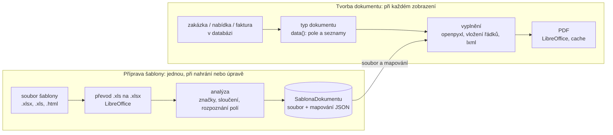

# Šablony dokumentů, PDF a ISDOC

Systém šablon určuje, jak se data uložená v databázi promění ve výsledný dokument: zakázkový list, cenovou nabídku nebo fakturu. Při jeho návrhu byl hlavním požadavkem firmy zachovat vzhled dosavadních Excelových formulářů a umožnit jejich pozdější úpravy bez zásahu do zdrojového kódu. Systém proto stojí na třech principech:

1.  **Oddělení dat a vzhledu.** Šablona obsahuje pouze vzhled dokumentu a informaci o tom, kam se vkládají jednotlivé údaje. Data dokumentu se vždy sestavují z databáze. Šablona nikdy data nemění a stejná data lze zobrazit v libovolné šabloně.

2.  **Šablonou je běžný soubor aplikace Excel.** Firma může vzít svůj stávající formulář, vložit do něj značky a nahrát ho do aplikace. Formátování, sloučené buňky, vzorce, obrázky i tvary zůstanou zachovány.

3.  **Rozšiřitelnost.** Typy dokumentů a formáty šablon jsou registrovány v kódu jako samostatné třídy, takže nový typ dokumentu nebo nový formát lze přidat bez změny ostatních částí.

Celý průběh od nahrání šablony po vytvoření PDF ukazuje diagram. Horní část znázorňuje přípravu šablony, která proběhne jednou při jejím nahrání nebo úpravě, dolní část tvorbu dokumentu, která proběhne při každém zobrazení.



*Příprava šablony a tvorba dokumentu*

## Typy dokumentů a katalog polí

Základem systému je modul `core/sablony/typy.py`, který pro každý typ dokumentu definuje, *jaké údaje* může dokument obsahovat. Aplikace zná tři typy dokumentů: zakázkový list (`zakazkovy_list`), cenovou nabídku (`nabidka`) a fakturu (`faktura`). Každý typ je třída odvozená od společné třídy `TypDokumentu`, zaregistrovaná dekorátorem `@registruj` do registru typů.

Každý údaj, který lze do šablony vložit, je popsán objektem `Pole` s těmito vlastnostmi:

- `klic` – jednoznačný název pole ve tvaru `skupina.nazev`, například `zakaznik.ico` nebo `dokument.datum_splatnosti`; právě tento klíč se zapisuje do značky v šabloně,

- `nazev` a `skupina` – popis pro uživatele, podle kterého se pole zobrazují v nápovědě a v editoru,

- `druh` – druh hodnoty (`text`, `cislo`, `penize`, `datum`, `obrazek`, `dlouhy_text`), podle kterého se hodnota formátuje a zapisuje do buňky,

- `synonyma` – popisky, podle kterých lze pole rozpoznat v šabloně bez značek (např. pro `soucty.s_dph` „celkem k úhradě“, „celkem s DPH“).

Pole jsou seskupena do skupin, které typy dokumentů sdílejí: Naše firma (`firma.*`), Zákazník (`zakaznik.*`), Zakázka (`zakazka.*`), Zařízení (`zarizeni.*`), Finanční údaje (`soucty.*`) a Dokument (`dokument.*`, pole specifická pro typ, například číslo, data a variabilní symbol u faktury). Kromě jednoduchých polí existují tři *seznamy*, tedy opakující se řádky: položky dokladu (`polozka.*`), řádky materiálu (`material.*`) a řádky prací (`prace.*`). Celkem nabízí každý typ dokumentu přibližně osmdesát polí.

Nejdůležitější metodou typu dokumentu je `data(objekt)`, která z objektu v databázi sestaví data dokumentu. Výsledek má vždy stejný tvar, nezávislý na typu dokumentu i na formátu šablony:

```python
{"pole": {"dokument.cislo": "001-27-10/2026",
          "dokument.datum_splatnosti": date(2026, 11, 10),
          "firma.nazev": "...", "zakaznik.ico": "12345678",
          "zakazka.cislo": "2026-048", "zarizeni.typ": "GSR 18V",
          "soucty.s_dph": Decimal("3633.75"), ...},
 "polozky":  [{"polozka.popis": "Diagnostika", "polozka.mnozstvi": Decimal("1"),
               "polozka.cena_bez_dph": Decimal("1500.00"), ...}, ...],
 "material": [{"material.nazev": "Ložisko 6204-2RS", ...}, ...],
 "prace":    [{"prace.popis": "Petr Svoboda: Diagnostika", ...}, ...]}
```

Při sestavení dat se využívají pomocné funkce, které odpovídají skupinám polí: `_firma()` načte údaje z nastavení firmy včetně cesty k logu, `_zakaznik()` údaje zákazníka (u nabídky a faktury přednostně z kopie uložené v dokladu), `_zakazka()` údaje zakázky a prvního zařízení a odvozená pole (pořadové číslo a rok zakázky, které se z čísla zakázky zjistí podle formátu číselné řady, takže z `ZL260001` vznikne rok 2026 a pořadí 0001, číslo objednávky a nabídky, seznam prací s pracovníky, úkony zakázky jedním řádkem, součty práce a materiálu), `_seznamy()` řádky materiálu a prací (název úkonu je jen název typu úkonu, interní poznámka k práci je jen v samostatném poli `prace.poznamka`) a `_soucty()` celkové součty z položek. Pořadové číslo dokladu (`dokument.poradove_cislo`) si u další nabídky ke stejné zakázce zachová příponu, např. `260002-2`. U zakázkového listu se položky sestavují z aktuálních prací a materiálu zakázky, u nabídky a faktury z položek uložených v dokladu. Metoda `ukazka()` vrací ukázková data stejného tvaru, která slouží k náhledu šablony a miniaturám bez nutnosti mít v databázi skutečnou zakázku.

## Uložení šablon

Každá šablona je jeden záznam v tabulce SablonaDokumentu (popsané v kapitole [Databáze](07-databaze.md#sablonadokumentu)). Záznam obsahuje typ dokumentu, formát (`excel` nebo `html`), soubor šablony, výsledek analýzy ve sloupci `mapovani` (JSON), miniaturu, příznaky výchozí a aktivní a číslo verze. Samotný soubor šablony je uložen jedním ze dvou způsobů:

- **Vestavěné šablony** jsou součástí zdrojového kódu ve složce `core/sablony/vzory/` (pro každý typ dokumentu „firemní“ a „standardní“ Excelová šablona, vygenerované příkazem `python manage.py vytvor_vzory_sablon`) a v `core/templates/sablony_vestavene/` (jednoduchá HTML šablona). Záznam má vyplněný sloupec `vestavena` s názvem souboru a prázdný sloupec `soubor`. Vestavěné šablony se vytvoří automaticky po instalaci a při aktualizaci aplikace se jejich mapování znovu analyzuje, takže se projeví i opravy vzorů.

- **Nahrané a upravené šablony** se ukládají do složky `media/sablony/`. Pokud uživatel vestavěnou šablonu upraví v editoru, uloží se upravený soubor do sloupce `soubor` a má přednost před vestavěným; akcí „Vrátit původní“ se soubor odstraní a šablona se opět řídí vestavěným vzorem.

Pro každý typ dokumentu je vždy nejvýše jedna šablona výchozí; při nastavení nové výchozí šablony metoda `save()` modelu zruší příznak u ostatních šablon téhož typu. Při deaktivaci výchozí šablony se výchozí stane jiná aktivní šablona. Při každé změně souboru se zvýší číslo verze, které se používá v názvech souborů miniatur a v klíči vyrovnávací paměti PDF.

## Přidání šablony do aplikace

Novou šablonu přidá uživatel v části Dokumenty → Šablony dokumentů tlačítkem pro novou šablonu. Ve formuláři zadá název, typ dokumentu, soubor a případně popis a zvolí, zda má být šablona výchozí. Po odeslání formuláře proběhnou tyto kroky (pohled `sablona_edit`):

1.  Podle přípony souboru se vybere renderer (`.xlsx`, `.xlsm` a `.xls` Excel, `.html` a `.htm` HTML). Nepodporovaný formát formulář odmítne.

2.  Soubor ve starém binárním formátu `.xls` se pomocí LibreOffice převede na `.xlsx`, protože knihovna openpyxl umí pracovat jen s novým formátem. Uživatel je o převodu informován.

3.  Renderer šablonu analyzuje metodou `analyzuj` a výsledek uloží do sloupce `mapovani`.

4.  Změna se zapíše do historie a uživatel je přesměrován na detail šablony, kde vidí miniaturu, rozpoznané značky a pole, případné neznámé značky a informace o listech sešitu. Šablonu si může zobrazit vyplněnou ukázkovými daty a zkontrolovat, že se údaje dostaly na správná místa.

## Rozpoznání jednotlivých částí šablony

Analýzu Excelové šablony provádí funkce `analyzuj` v modulu `excel.py`. Načte sešit knihovnou openpyxl a u každého listu zaznamená jeho název, použitý rozsah, sloučené oblasti, tiskovou oblast a počet obrázků. Poté prochází všechny buňky a hledá v nich *značky*.

### Značky

Značka je text ve tvaru `{{skupina.pole}}`, například `{{zakaznik.nazev}}`. Vyhledává se regulárním výrazem `\{\{\s*([a-z_]+\.[a-z_]+)\s*\}\}`. Značka může tvořit celý obsah buňky, nebo může být součástí delšího textu, například `Faktura č. {{dokument.cislo}}`, a v jedné buňce může být i více značek. Pro každou nalezenou značku se uloží klíč pole, název listu a oblast buňky. Značky, jejichž klíč neodpovídá žádnému poli daného typu dokumentu (typicky překlep), se uloží zvlášť jako *neznámé značky* a aplikace na ně uživatele upozorní.

### Opakující se řádky

Řádek, který obsahuje značku některého ze seznamů (`{{polozka.…}}`, `{{material.…}}` nebo `{{prace.…}}`), je vzorový řádek tabulky. Při tvorbě dokumentu se zopakuje pro každou položku seznamu. Na jednom listu může být více takových tabulek, například zvlášť tabulka prací a zvlášť tabulka materiálu.

### Rozpoznání bez značek

Pokud šablona neobsahuje žádné značky (například uživatel nahraje svůj původní formulář beze změn), pokusí se funkce `rozpoznej` najít místa pro údaje podle popisků v šabloně. Texty buněk i synonyma polí se nejprve normalizují: odstraní se diakritika, převedou se na malá písmena a odstraní se dvojtečky a nadbytečné mezery. Poté se postupuje ve dvou krocích:

1.  *Tabulka položek* se hledá jako první řádek, ve kterém alespoň tři buňky odpovídají názvům sloupců položek (např. „Popis“, „Množství“, „Cena za MJ“, „Celkem“). Řádek pod touto hlavičkou se považuje za vzorový řádek a zaznamená se, do kterého sloupce patří které pole. Sloupce, které už v šabloně obsahují vzorec, se nepřepisují.

2.  *Jednoduchá pole* se hledají u buněk, jejichž text odpovídá některému synonymu (přesně, nebo jako začátek textu). Hodnota se pak zapíše do nejbližší prázdné oblasti vpravo od popisku (nejvýše šest sloupců daleko), případně do buňky pod popiskem. Buňka se vzorcem se nepřepisuje, protože hodnotu v ní počítá šablona sama. Přednost mají přesné shody a delší synonyma a každé pole i každá buňka se použije nejvýše jednou.

Výsledek automatického rozpoznání je pouze návrh. Uživatel ho vidí v detailu šablony a v editoru, kde ho může opravit.

## Mapování dat na jednotlivé buňky

Aplikace tedy zná dva způsoby, jak určit, kam se má který údaj zapsat:

1.  **Značkou v buňce.** Umístění je dáno přímo souborem šablony. Tento způsob je nejspolehlivější a doporučený.

2.  **Mapováním.** Umístění je uloženo ve sloupci `mapovani` jako seznam dvojic pole–oblast a seznam tabulek. Mapování vzniká automatickým rozpoznáním šablony bez značek.

Struktura mapování uloženého ve formátu JSON vypadá takto: Seznam `znacky` obsahuje značky nalezené v souboru, seznam `pole` jednotlivá rozpoznaná pole s cílovou oblastí a popiskem, podle kterého byla nalezena, a seznam `tabulky` vzorové řádky tabulek s přiřazením sloupců k polím.

```json
{"verze": 1,
 "listy": [{"nazev": "Faktura", "rozsah": "A1:I58",
            "sloucene": ["C7:F7", ...], "obrazky": 1}],
 "znacky": [{"pole": "dokument.cislo", "list": "Faktura", "oblast": "G2:I2"}],
 "nezname_znacky": [],
 "pole":    [{"pole": "zakaznik.ico", "list": "Faktura", "oblast": "C12:D12",
              "popisek": "B12 „IČO:“", "zdroj": "auto"}],
 "tabulky": [{"list": "Faktura", "radek": 21, "oblast": "B21:I21",
              "sloupce": {"C": "polozka.popis", "F": "polozka.mnozstvi",
                          "H": "polozka.cena_bez_dph"}, "zdroj": "auto"}]}
```

Oba způsoby lze kombinovat. Webový editor šablon však při otevření převede automaticky rozpoznaná pole na značky (funkce `_z_mapovani`), aby je uživatel viděl přímo v buňkách a mohl je přesouvat. Po uložení v editoru jsou tak všechna pole vyjádřena značkami a automatické mapování se vyprázdní.

## Dosazení údajů z databáze

Vyplnění šablony provádí funkce `vypln` v modulu `excel.py`. Pracuje vždy s kopií sešitu v paměti, původní soubor šablony se nikdy nemění. Postup je následující:

1.  Vyhledají se všechny tabulky, tedy vzorové řádky z mapování i řádky se značkami seznamů, a vyplní se *odspodu nahoru*. Vložení řádků do spodní tabulky tak neposune řádky tabulek nad ní, jejichž pozice jsou již známé.

2.  Ve všech buňkách se nahradí značky jednoduchých polí hodnotami.

3.  Zapíší se pole z mapování; jejich cílová oblast se přitom posune o počet řádků vložených nad ní.

Způsob zápisu hodnoty závisí na tom, zda značka tvoří celý obsah buňky:

- Je-li v buňce *jen značka*, zapíše se *skutečná hodnota* odpovídajícího typu: číslo jako číslo, datum jako datum. Excel (a LibreOffice při převodu do PDF) s ní pak může počítat ve vzorcích šablony. Pokud buňka nemá vlastní formát čísla, nastaví se český formát: peníze `#,##0.00 "Kč"` (nebo jiná měna podle nastavení firmy), datum `D. M. YYYY`, ostatní čísla `#,##0.###`. Má-li buňka formát nastavený v šabloně, zůstane zachován.

- Je-li značka *součástí textu*, nahradí se textem naformátovaným funkcí `formatuj` (např. `1 500,00 Kč` nebo `27. 10. 2026`).

- Hodnoty s více řádky (adresa, seznam zařízení, seznam prací) zapnou v buňce zalamování textu.

- Pole druhu obrázek (logo firmy) se nevkládá jako text, ale jako obrázek ukotvený v levém horním rohu oblasti; jeho velikost se zmenší tak, aby se do oblasti vešel se zachováním poměru stran.

## Práce s vícebuňkovými oblastmi

Firemní formuláře intenzivně využívají sloučené buňky, například název zákazníka přes několik sloupců nebo popis položky přes polovinu šířky stránky. Systém šablon proto nepracuje s jednotlivými buňkami, ale s *oblastmi*. Funkce `oblast_bunky` vrátí pro každou buňku sloučenou oblast, do které patří (např. `C7:F7`), nebo samotnou buňku. V Excelu nese hodnotu sloučené oblasti vždy její levá horní buňka, ostatní buňky jsou prázdné (v openpyxl objekty `MergedCell`); aplikace proto čte i zapisuje vždy levou horní buňku a ostatní buňky oblasti přeskakuje. Do mapování se ukládá celá oblast, aby bylo možné spočítat její rozměry (např. pro zmenšení loga) a zobrazit ji v editoru jako jeden celek.

Nejsložitější částí je **rozšíření tabulky položek**. Faktura může mít jednu položku i dvacet, přitom šablona obsahuje jen jeden vzorový řádek a pod tabulkou často pokračuje dalším obsahem (součty, platební údaje, podpisy). Funkce `_vypln_tabulku` postupuje takto:

1.  Zjistí rozsah sloupců vzorového řádku včetně sloučených buněk, které do něj zasahují.

2.  Zjistí *kapacitu* tabulky: kolik prázdných řádků s ohraničením následuje pod vzorovým řádkem. Formuláře mívají tabulku položek předkreslenou na několik řádků a ty se využijí bez vkládání.

3.  Pokud je položek více, než je kapacita, vloží funkce `vloz_radky` chybějící řádky pod tabulku. Při tom:

    - posune všechny sloučené oblasti pod místem vložení a oblasti, které místem vložení procházejí, prodlouží,

    - vytvoří ve vložených řádcích stejná sloučení, jaká má vzorový řádek,

    - posune výšky řádků a vloženým řádkům nastaví výšku a styly (písmo, ohraničení, zarovnání, formát čísla) vzorového řádku,

    - upraví odkazy ve všech vzorcích listu: odkazy pod místem vložení se posunou a oblasti, které končí v tabulce, se prodlouží, takže například `=SUM(H21:H21)` se změní na `=SUM(H21:H25)`,

    - posune ukotvení obrázků a tiskovou oblast.

4.  Do každého řádku tabulky zkopíruje značky a vzorce vzorového řádku (vzorce se přeloží na nový řádek, např. `=F21*G21` na `=F22*G22`) a nahradí značky údaji příslušné položky. Ostatní text vzorového řádku se neopakuje.

5.  Ve zbylých předkreslených řádcích, pro které nejsou data, značky smaže, aby v dokumentu nezůstal text `{{…}}`.

Funkce vrací, pod kterým řádkem a kolik řádků bylo vloženo. Tuto informaci využívá modul `kresby.py`: knihovna openpyxl totiž při uložení zachová obrázky, ale ztratí grafické tvary (rámečky, čáry, textová pole), které jsou ve formulářích běžné. Funkce `zachovej` proto po vyplnění otevře původní i vyplněný soubor jako archivy ZIP, pomocí knihovny lxml přenese definici kreseb z původního souboru do výsledného, posune jejich ukotvení o vložené řádky, připojí obrázky přidané při vyplnění (logo) a doplní potřebné vztahy a typy obsahu balíčku Office Open XML. Pokud by se přenos tvarů nezdařil, dokument se vytvoří bez nich, ale vytvoření dokumentu neselže.

## Úprava šablony

Šablonu lze upravit dvěma způsoby. Prvním je úprava souboru v Excelu: uživatel si šablonu stáhne, upraví ji, například doplní značky podle nápovědy „Značky pro vlastní šablony“, a nahraje ji zpět. Při nahrání nového souboru se zvýší verze šablony a šablona se znovu analyzuje.

Druhým způsobem je **webový editor šablon** přímo v aplikaci, který nevyžaduje Excel a je určen zejména k umístění polí. Editor zobrazí list šablony jako mřížku buněk se zachovanými šířkami sloupců, výškami řádků, sloučenými oblastmi, písmem, zarovnáním, výplní a ohraničením (data připraví funkce `mrizka` v `excel.py`). Tvary a obrázky z Excelu jsou znázorněny přerušovanými rámečky (funkce `obrysy` v `kresby.py`). Značky se v buňkách zobrazují jako barevné štítky s českým názvem pole; štítky polí opakujících se řádků mají jinou barvu a řádek, který se bude opakovat, je zvýrazněn. Uživatel v editoru může:

- přetáhnout pole z panelu polí (s vyhledáváním podle názvu) do buňky nebo na pole kliknout a vložit ho do vybrané buňky,

- přesunout štítek pole do jiné buňky nebo ho odebrat křížkem,

- přepsat text buňky včetně kombinace textu a značek, například `Výrobce: {{zarizeni.vyrobce}}`,

- vymazat obsah buněk, sloučit vybranou oblast nebo sloučení zrušit,

- vracet změny zpět (až 100 kroků) a zobrazit náhled uložené verze s ukázkovými daty.

Editor si změny pamatuje v prohlížeči a při uložení je odešle serveru jako JSON se třemi seznamy: změny obsahu buněk, nová sloučení a zrušená sloučení. Funkce `uprav` je aplikuje na sešit knihovnou openpyxl (texty, které vypadají jako čísla, uloží jako čísla), zachová tvary pomocí `kresby.py` a vrátí nový soubor. Ten se uloží jako nová verze s názvem obsahujícím číslo verze; posledních deset předchozích souborů zůstává uloženo a starší se mažou. Šablona se poté znovu analyzuje. Další akce v detailu šablony umožňují vytvořit kopii šablony, šablonu znovu načíst a rozpoznat pole, nastavit ji jako výchozí, deaktivovat ji nebo vestavěnou šablonu vrátit do původní podoby.

## HTML šablony

Kromě Excelových šablon podporuje aplikace i šablony ve formátu HTML, které využívají šablonovací jazyk Django. Data se do HTML šablony předávají jako vnořené slovníky (funkce `html_kontext`), takže šablona používá zápis `{{ firma.nazev }}`, `{{ dokument.cislo }}` a pro položky cyklus `{{ p.popis }}`. Hodnoty jsou již naformátované česky. Výhodou HTML šablon je, že se náhled zobrazí přímo v prohlížeči i bez LibreOffice a tabulka položek se přirozeně přizpůsobí počtu položek. S aplikací je dodávána jednoduchá HTML šablona pro všechny tři typy dokumentů, která slouží i jako záložní řešení na počítači bez LibreOffice.

## Export do PDF

Na požadavek o PDF zavolá pohled `dokument_pdf` metodu `pdf` rendereru zvolené šablony:

1.  Spočítá se klíč vyrovnávací paměti: haš SHA-1 z identifikace a verze šablony, času poslední změny jejího souboru, mapování a kompletních dat dokumentu. Pokud již PDF s tímto klíčem ve složce `media/cache/dokumenty/` existuje, vrátí se okamžitě.

2.  Jinak renderer vytvoří vyplněný sešit (funkce `vypln` a `zachovej`) a uloží ho do dočasné složky jako `dokument.xlsx`; HTML šablona se vykreslí a uloží jako `dokument.html`.

3.  Funkce `na_pdf` spustí LibreOffice (`soffice --headless --convert-to pdf`) s vlastním profilem s českým národním prostředím. LibreOffice při převodu přepočítá vzorce šablony, respektuje tiskovou oblast, nastavení stránky, sloučené buňky, ohraničení, obrázky i tvary. Převody probíhají postupně (zámek), aby se dva současné převody nepoškodily, a mají časový limit 120 sekund.

4.  PDF se uloží do vyrovnávací paměti a odešle prohlížeči s názvem souboru podle typu dokumentu (`ZL_048.pdf`, `DMN_048.pdf`, `Fa001.pdf`).

Tisk dokumentu probíhá z náhledu v prohlížeči, který PDF nebo HTML zobrazuje ve vloženém rámu. Miniatury šablon vznikají stejnou cestou z ukázkových dat; z PDF se vykreslí první strana knihovnou pypdfium2 a uloží se jako PNG. Miniatura se vytváří jen jednou pro každou verzi šablony.

## Export do formátu ISDOC

ISDOC (Information System Document) je český standard pro výměnu elektronických faktur ve formátu XML, který spravuje Ministerstvo vnitra ČR a který podporuje většina tuzemských účetních programů. Faktura ve formátu ISDOC obsahuje strukturovaná data (dodavatel, odběratel, data, položky, sazby a částky DPH, platební údaje), díky kterým ji příjemce může načíst do účetnictví bez přepisování. Aplikace vytváří fakturu ve verzi formátu 6.0.2 jako soubor s příponou `.isdoc`.

ISDOC na rozdíl od PDF nepopisuje vzhled dokumentu, ale pouze jeho data. Proto nevzniká ze šablony, ale přímo z dat dokumentu: modul `core/sablony/isdoc.py` převezme výsledek metody `data()` typu dokumentu Faktura, tedy stejná data, ze kterých se vyplňuje šablona PDF, a knihovnou lxml z nich sestaví dokument XML. Tištěná faktura a faktura ISDOC proto vždy obsahují stejné položky a částky. Přiřazení údajů aplikace k prvkům formátu ISDOC ukazuje následující tabulka.

| **Prvek ISDOC**             | **Zdroj v aplikaci**                                                                                   |
|:----------------------------|:-------------------------------------------------------------------------------------------------------|
| `DocumentType`              | pevně 1 (faktura – daňový doklad)                                                                      |
| `ID`, `UUID`                | `dokument.cislo`; UUID odvozené z identifikace faktury                                                 |
| `IssueDate`, `TaxPointDate` | `dokument.datum_vystaveni`, `dokument.duzp`                                                            |
| `VATApplicable`             | podle toho, zda má firma vyplněné DIČ                                                                  |
| `LocalCurrencyCode`         | `soucty.mena`                                                                                          |
| `AccountingSupplierParty`   | `firma.nazev`, `firma.adresa`, `firma.ico`, `firma.dic`, `firma.telefon`, `firma.email`                |
| `AccountingCustomerParty`   | `zakaznik.firma` nebo `zakaznik.jmeno`, `zakaznik.adresa`, `zakaznik.ico`, `zakaznik.dic`              |
| `InvoiceLines`              | seznam `polozky` (popis, množství, jednotka, jednotková cena, sazba DPH, ceny bez a s DPH)             |
| `TaxTotal`                  | rekapitulace DPH vypočtená z položek podle sazeb                                                       |
| `LegalMonetaryTotal`        | součty bez DPH, s DPH a částka k úhradě                                                                |
| `PaymentMeans`              | `firma.cislo_uctu` (číslo účtu a kód banky), `dokument.datum_splatnosti`, `dokument.variabilni_symbol` |

*Přiřazení údajů faktury k prvkům formátu ISDOC*

Při převodu je třeba vyřešit několik rozdílů mezi tím, jak údaje eviduje aplikace, a tím, jak je vyžaduje formát ISDOC:

- **Adresa.** Aplikace ukládá adresu jako jeden text (např. „Hlavní 123, 400 01 Ústí nad Labem“), ISDOC ji vyžaduje rozdělenou na ulici, číslo domu, PSČ a město. Funkce `rozdel_adresu` ji rozdělí podle čárky a regulárních výrazů pro číslo domu a PSČ. Část, kterou nelze rozpoznat, zůstane v poli ulice nebo města, aby se žádný údaj neztratil.

- **Bankovní účet.** Číslo účtu ve tvaru `123-4567890/0800` se rozdělí na číslo účtu a kód banky; pokud je v nastavení zapsán IBAN, uloží se do pole IBAN. Je-li účet vyplněn, faktura uvádí platbu převodem (kód 42), jinak platbu v hotovosti (kód 10).

- **Rekapitulace DPH.** ISDOC vyžaduje součty základu, daně a celkové částky zvlášť pro každou sazbu DPH. Modul je vypočítá z položek faktury; DPH se počítá „zdola“, tedy z ceny bez DPH, stejně jako v modelu položky.

- **Jednoznačný identifikátor.** Každá faktura ISDOC musí mít identifikátor UUID. Aplikace ho neukládá do databáze, ale odvozuje funkcí `uuid5` z identifikace faktury, takže stejná faktura dostane při každém exportu stejné UUID.

- **Faktura bez položek.** Pokud faktura obsahuje jen celkovou částku, vytvoří se jeden řádek s touto částkou a sazbou DPH dopočtenou z poměru daně a základu.

Hotový dokument se před odesláním uživateli ověří proti oficiálnímu schématu XSD formátu ISDOC 6.0.2, které je součástí aplikace (`core/sablony/schemata/`). Pokud by dokument schématu neodpovídal, uživatel místo souboru uvidí chybové hlášení s popisem problému, takže aplikace nikdy nevydá neplatnou fakturu. Správnost převodu ověřují automatické testy aplikace (`core/tests.py`), které vytvoří zkušební faktury, převedou je do formátu ISDOC a kontrolují platnost podle schématu i vypočtené částky.

Formát ISDOC počítá i s fakturou v cizí měně přepočtenou kurzem na koruny. Aplikace kurz zatím neeviduje, a proto fakturu vždy uvádí v měně nastavené ve firmě.

## Import přijatých faktur ve formátu ISDOC

Stejný modul pracuje s formátem ISDOC i v opačném směru: čte faktury, které firmě posílají dodavatelé, a převádí je na záznamy přijatých faktur (viz [Evidence přijatých faktur](02-funkce.md#evidence-přijatých-faktur)). Funkce `nacti` přijme obsah nahraného souboru a vrátí slovník s údaji faktury a dodavatele. Postupuje v těchto krocích:

1.  **Rozbalení.** Pokud soubor začíná signaturou archivu ZIP, jde o formát ISDOCX (faktura ISDOC zabalená spolu s přílohami, obvykle s PDF). Z archivu se vybere soubor s příponou `.isdoc`.

2.  **Načtení XML.** Dokument se načte knihovnou lxml s vypnutým rozbalováním entit a přístupem k síti, aby nahraný soubor nemohl číst jiné soubory serveru ani posílat požadavky jinam (ochrana proti útoku typu XXE). Kořenový prvek musí být `Invoice` ze jmenného prostoru `isdoc.cz`, jinak se soubor odmítne se srozumitelnou chybou.

3.  **Vyhledání údajů.** Údaje se hledají podle místních názvů prvků bez ohledu na jmenný prostor. Díky tomu aplikace přečte faktury ve verzi ISDOC 6 i ve starší verzi 5, které se liší právě jmenným prostorem. Načte se číslo faktury, druh dokladu, data vystavení, DUZP a splatnosti, dodavatel (název, IČO, DIČ, adresa složená z ulice, čísla, PSČ a města, telefon, e-mail), účet a variabilní symbol z platebních údajů, částky bez DPH, DPH a k úhradě a názvy položek.

4.  **Kontrola.** Na rozdíl od exportu se přijatá faktura neověřuje celým schématem XSD. Účetní programy dodavatelů se schématu drží různě přesně a přísná kontrola by odmítla i fakturu, ze které lze všechny potřebné údaje přečíst. Vyžaduje se proto jen to, bez čeho záznam nemá smysl: číslo faktury a údaje o dodavateli.

Načtená data zpracuje pohled popsaný v kapitole [Evidence přijatých faktur](02-funkce.md#evidence-přijatých-faktur): dohledá nebo založí dodavatele, uloží přijatou fakturu s původním souborem a zapíše události do kalendáře. Položky faktury se jako samostatné záznamy neukládají, protože aplikace přijaté faktury eviduje kvůli úhradám a přehledu nákladů, nikoli kvůli skladové evidenci; jejich názvy se uloží do poznámky faktury, aby bylo z detailu patrné, za co faktura je.
